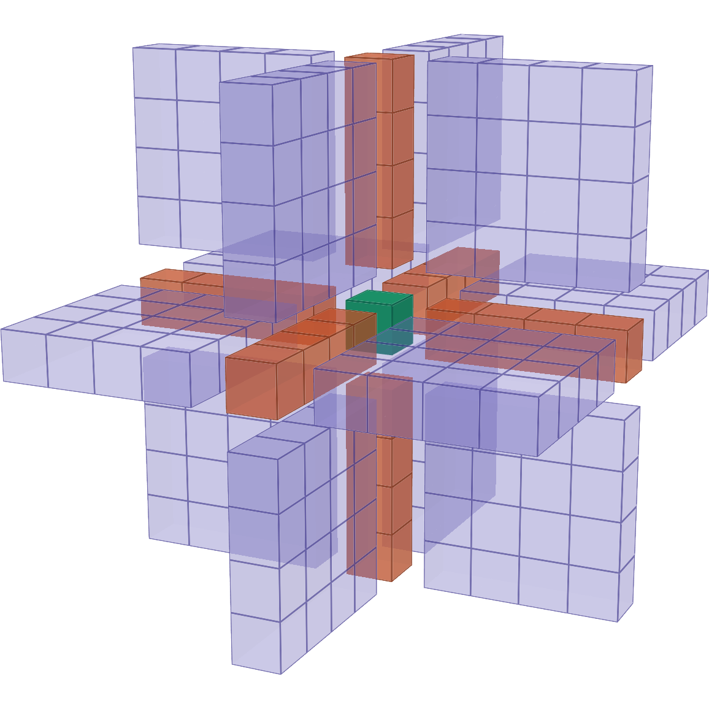
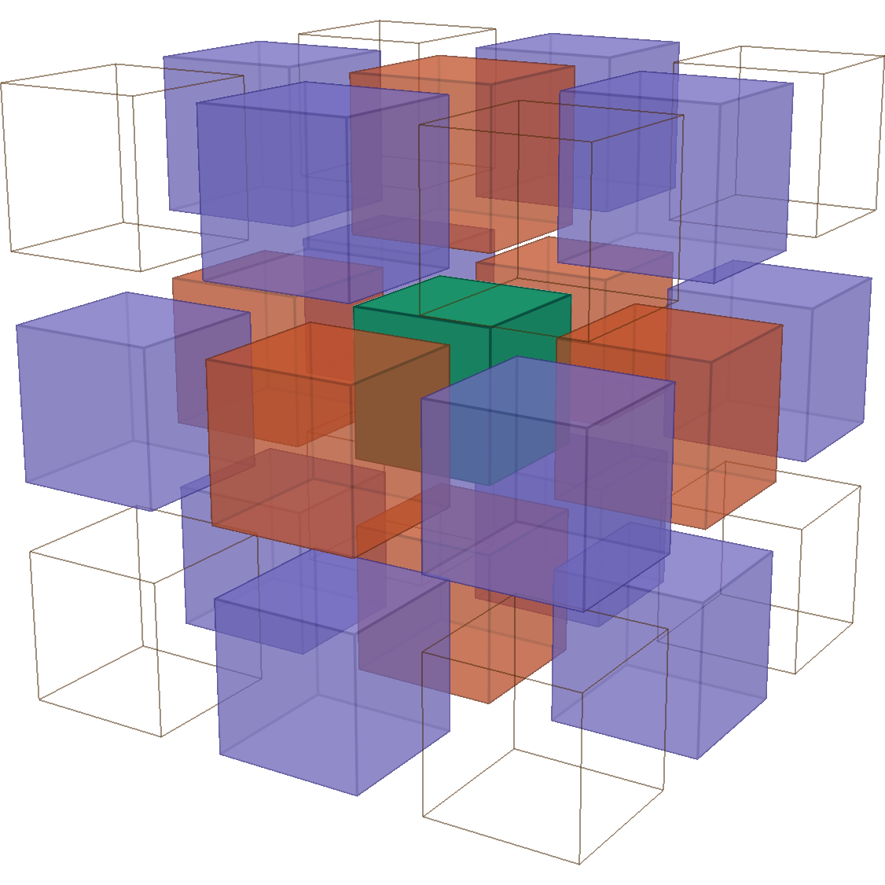

# -*- coding: utf-8 -*-
# -*- mode: org -*-

#+TITLE: Implementation and Evaluation of a Task-Based Forward Fletcher Seismic Analysis Algorithm on Multiple CPU Architectures
#+AUTHOR: Anonymous

#+STARTUP: overview indent
#+LANGUAGE: en
#+OPTIONS: H:3 creator:nil timestamp:nil skip:nil toc:nil num:t ^:nil ~:~
#+OPTIONS: author:nil title:nil date:nil
#+TAGS: noexport(n) deprecated(d) ignore(i)
#+EXPORT_SELECT_TAGS: export
#+EXPORT_EXCLUDE_TAGS: noexport

#+LATEX_CLASS: IEEEtran
#+LATEX_CLASS_OPTIONS: [conference]

#+LATEX_HEADER: \sloppy
#+LATEX_HEADER: \usepackage{censor}
#+LATEX_HEADER: %\StopCensoring
#+MACRO: m @@latex:\mach{$1}@@
#+LATEX_HEADER: \makeatletter\let\orig@includegraphics\includegraphics\renewcommand{\includegraphics}[2][]{\ifcensor\filename@parse{#2}\IfFileExists{\filename@area\filename@base-anon.\filename@ext}{\orig@includegraphics[#1]{\filename@area\filename@base-anon.\filename@ext}}{\orig@includegraphics[#1]{#2}}\else\orig@includegraphics[#1]{#2}\fi}\makeatother
#+LATEX_HEADER: \makeatletter\newcommand{\mach}[1]{\ifcensor\@nameuse{anon@#1}\else #1\fi}\makeatother
#+LATEX_HEADER: \makeatletter\@namedef{anon@draco}{M1}\@namedef{anon@poti}{M2}\@namedef{anon@cei}{M3}\@namedef{anon@grace}{M4}\@namedef{anon@Grace}{M4}\@namedef{anon@tupi}{M5}\@namedef{anon@lunaris}{M6}\@namedef{anon@Lunaris}{M6}\makeatother
#+LATEX_HEADER: \usepackage{booktabs}
#+LATEX_HEADER: \usepackage{tikz}
#+LATEX_HEADER: \usetikzlibrary{positioning, arrows.meta}
#+LATEX_HEADER: \usepackage{float}
#+LATEX_HEADER: \usepackage{algorithm}
#+LATEX_HEADER: \usepackage{algpseudocode}
#+LATEX_HEADER: \usepackage{tabularx}

# PDF generation can be done by make (thanks Luka Stanisic)
#   or C-c C-e l p (thanks Vinicius Garcia)

# visual-line-mode [enable]
# auto-fill-mode [disable]

#+PROPERTY: header-args :eval never-export :exports none

# keywords:
# Heterogeneous CPU Computing
# Multiple CPU Architectures
# Overlapping I/O with Computation
# Reverse Time Migration
# Sequential Task Flow
# StarPU
# Fletcher

* PDP 2027 Call for Papers                                         :noexport:

Source: https://www.pdp2027.org/ (iframe of
https://research.ac.upc.edu/PDP2027/index.html), downloaded 2026-10-22.

** Conference

35th Euromicro Conference on Parallel, Distributed and Network-Based
Processing (PDP 2027).

- Location :: Barcelona, Catalonia, Spain
- Dates :: 17–19 March 2027
- Proceedings :: IEEE CPS · Scopus-indexed
- Organizers :: Universitat Politècnica de Catalunya - BarcelonaTech;
  Barcelona Supercomputing Center - BSC-CNS
- Submission system :: https://easychair.org/my/conference?conf=pdp2027
- Contact :: pdp2027@ac.upc.edu

PDP stands as a premier European and international conference that
comprehensively addresses all facets of parallel and distributed
processing. Encompassing a spectrum from foundational theory to
practical implementation, it spans systems of all scales—from small
configurations to the largest infrastructures. PDP addresses
fundamental computational challenges alongside robust applications and
delves into architecture, compiler, language, interface design and
deployment, tools, support infrastructures, and performance
optimization.

Parallel, Distributed, and Network-Based Processing fields have evolved
significantly, marked by the emergence of novel architectures and
groundbreaking applications. Artificial intelligence (AI) has become a
major application area, leveraging parallel and distributed
technologies to enhance computational efficiency and enable
sophisticated AI models. This progress emphasizes the dynamic fusion of
parallel and distributed technologies with other rapidly advancing
domains. In evaluating these cutting-edge developments, it is
imperative to highlight the latest research achievements in
established areas of parallel and distributed computing, drawing
insights from both industrial and academic perspectives.

PDP 2027 brings researchers and practitioners together in Barcelona to
present new work and discuss where the field is heading next. Accepted
papers are published through IEEE Conference Publishing Services (CPS)
and submitted for indexing in Scopus and other major indexing services.

** Topics of interest

PDP welcomes original, unpublished work across (but not limited to) the
following areas.

1. Algorithms :: Resource-aware & power-efficient algorithms; real-time
   and fault-tolerant distributed/parallel algorithms; graph and network
   algorithms.
2. Applications :: Numerical and scientific applications with
   multi-level parallelism; computations over irregular domains.
3. Data-centric processing :: Scientific workflows; large-scale data
   processing & management; next-generation storage; FAIR/open data
   systems.
4. Distributed AI :: Federated and distributed learning; AI at scale;
   training of LLMs; benchmarking for AI workloads.
5. Distributed computing :: Cluster, grid, fog/edge, mobile and cloud
   systems; service-oriented processing; cost, security & energy models.
6. Parallel computing :: Accelerator-based systems (GPU, FPGA,
   neuromorphic, post-CMOS); embedded parallel systems; fault tolerance.
7. Programming models & tools :: Languages, compilers, middleware and
   OS; libraries, runtime and systems software; performance prediction.
8. HPC state of practice :: Managing systems, storage & facilities; HPC
   in the cloud; networking and cybersecurity; training strategies.
9. Systems & architectures :: High-throughput & streaming
   architectures; heterogeneous and hybrid systems; post-CMOS
   architectures.

** How to submit

Papers report original, unpublished work and are reviewed double-blind.
The review process is double-blind and all papers need to be
“best-effort” anonymized. We strongly encourage making code and data
available anonymously (e.g., in an anonymous GitHub repository via
Anonymous GitHub or in a Dropbox folder).

- Page limit :: Full papers: up to 8 pages.
- Double-blind :: Remove author names, affiliations, and identifying
  acknowledgements from the manuscript prior to submission.
- Proceedings :: Accepted papers are published through IEEE CPS and
  submitted for indexing in Scopus and other major services.
- Author registration :: At least one author of each accepted paper
  must register with a regular registration and present the paper at
  the conference.
- Paper templates :: All submissions must follow the IEEE Conference
  Proceedings Format (double-column, 10pt size fonts). LaTeX and Word
  templates: https://www.ieee.org/conferences/publishing/templates

** Important dates

All deadlines are firm, AoE times.

| Date                         | Event                           | Status        |
|------------------------------+---------------------------------+---------------|
| 31 Aug 2026 → 11 Sept 2026   | Special session proposals due   | Closed        |
| 19 Oct 2026                  | Abstract registration deadline  | Open          |
| 26 Oct 2026                  | Submission deadline             | Main deadline |
| 7 Dec 2026                   | Author notification             | Confirmed     |
| 25 Jan 2027                  | Camera-ready (all tracks)       | Confirmed     |
| 17–19 Mar 2027               | Conference dates                | Confirmed     |

** Special sessions

Co-located sessions running alongside the main track, each with its own
scope, chairs, and program committee. Papers are submitted as tracks in
the same multi-track EasyChair installation as the main conference.

- DT4DC :: Digital Twins for Energy-Efficient Data Centers
- HPCMS :: High Performance Computing in Modelling and Simulation
- RM-HPC-QC :: Resource Management in HPC-QC Environments
- SimCOT :: Simulation of Distributed Systems across the
  Cloud-to-Thing Continuum
- SPDNBC :: Security in Parallel, Distributed, and Network-Based
  Computing
- AHPC³ :: Accelerated HPC in the Cloud-Edge Continuum

* *The Paper*                                                       :ignore:
** Frontpage                                                        :ignore:

#+BEGIN_EXPORT latex
\makeatletter
\let\orgtitle\@title
\makeatother

\title{\orgtitle}

\author{
\IEEEauthorblockN{\censor{Pedro Henrique Boniatti Colle},
   \censor{Lucas Mello Schnorr}}
\IEEEauthorblockA{\censor{Institute of Informatics, Federal University of Rio Grande do Sul (UFRGS)} \\
\censor{Porto Alegre, Brazil} \\
\censor{\{phbcolle,schnorr\}@inf.ufrgs.br}}}
#+END_EXPORT

#+LaTeX: \maketitle

** Abstract                                                         :ignore:

#+begin_abstract
Fletcher is a seismic analysis algorithm widely used in oil and gas exploration. It is a Reverse Time Migration (RTM) algorithm that is computationally and I/O-Intensive. This paper presents Star-Fletcher, an implementation of the forward phase of the Fletcher RTM algorithm using the Sequential Task Flow (STF) paradigm, implemented with StarPU. By segmenting the computational domain into blocks and scheduling them as dependent tasks, Star-Fletcher enables overlap of computation and I/O, eliminating global synchronization points between iterations. This paper bases its analysis on the OpenMP base version, fletcher-base, and characterizes its performance across OpenMP configurations. Experiments across multiple CPU architectures show that Star-Fletcher outperforms the OpenMP baseline implementation with static partitioning and either matches or surpasses it with dynamic scheduling. The most significant gains are observed on heterogeneous architectures featuring mixed performance and efficiency cores. 
#+end_abstract

** Introduction
<<sec:intro>>

*** Structure                                                   :noexport:
**** Context [problema identificação]
1. RTM => Fletcher é uma forma de fazer RTM that considers Tilted Transverse Isotropic (TTI)
   - How it works? Multiple shots are computed, it is their aggregation that allows a seismic image to be created
     - XX Reverse Time Migration (RTM) is an important algorithm for the oil and gas industry. With it, geophone-recorded data can be analyzed to detect subsurface oil and gas deposits. When dealing with a Tilted Transverse Isotropic (TTI) medium, the Fletcher algorithm [1] is used, which is more suitable for multiple types of recorded media. It works by propagating a wave field forward in time, recording it, and then integrating the recording back in time to generate a partial image.
   - Each shot is very compute-bound, and consists of a forward and a backward phase. Each shot is independent.
     - XX There are no dependencies between shots, so the common approach to apply parallelism in RTM applications is to use MPI to distribute each shot to each node and within each node speed up computation using threads or hardware accelerators.
   - In an ideal scenario, the full volume could be kept in-memory so that the backward phase reads the output of the forward phase. However, because the volume is very large, frequently one decides to register it in secondary storage. This ultimately leads to a IO-bound application.
2. The common parallelization approach of each shot is to use traditional MPI+X or just X in scenarios where multiple shots are necessary to build a full seismic image of the marine subsurface.
   - XX This common parallelization approach will be harder when nodes’ architectures become increasingly heterogeneous because one usualy uses 2D block cyclic partitioning: in the processor case, with non-uniform memory access and mixed P-core/E-core architectures; and in the hardware accelerators case, with multiple types of accelerators such as GPUs, TPUs, and FPGAs.
   - For example, there is "a base implementation that uses OpenMP, called fletcher-base [9]," that paralelizes only the foward phase of the RTM for each shot.
3. Somehow include IO discussion here [it is already here]
**** Toward a task-based solution [em direção a solução]
- An alternative programming model to tackle this problem is the task-based paradigm ...
  - Explain what is the task-based paradigm for a newbie
    - Dependent sequential tasks, way to explicit dependencies RAW WAR WAW, DAG, how to submit the DAG => Sequential Task Flow (STF)
- STF Dongarra support
  - XX In 2013, Dongarra [2] already proposed the Sequential Task Flow (STF) model, arguing that it is better equipped to handle heterogeneous computing environments. Many applications have successfully adopted this paradigm across a plethora of contexts, such as dense linear algebra [3], Computational Fluid Dynamics (CFD) [4], [5], and Reverse Time Migration (RTM) applications [6], [7].
- It is the different scheduling policies implemented in a runtime that enables exploration of all available computational resources after the programmer segmented computations into those dependent tasks. The runtime will balance the work across resources.
**** Related work [quem já fez? quem já tentou resolver]
***** Paragraph starting with "Related work consists of. ..."
- Which works already used the task-based paradigm for the application we use.
- For each one, detail its inner workings.
***** This paragraph ends with a  **** Related Work Comparison
- Quick discussion about the differences of your approach against those others that you used as motivation.
**** Star-Fletcher is a task-based [o meu é o melhor, vou apresentá-lo]
As in the current version.
**** One paragraph with main Results [os principais resultados, vangloriando-se quantitativamente contra os trabalhos relacionados, OU qualitativamente]
**** Paper structure
*** Refined Structure                                           :noexport:
Each block below is one paragraph (~1 column in total). The thread
(encadeamento): the three limitations of P2 map one-to-one to the
contributions in P5 and to the results in P6.
**** P1 - Context: RTM, Fletcher, and why the forward phase [problema]
- RTM in oil and gas: shots, each with a forward and a backward phase; shots are independent.
- Fletcher = pseudo-acoustic wave equation for TTI media, the propagator used in *both* phases (not "a way of doing RTM").
- The forward phase is both compute- and IO-intensive: it writes the volume every $k$ steps so that the backward phase can read it back (secondary storage because the volume does not fit in memory).
  - This is what justifies studying only the forward phase, and using /fletcher-base/ (forward-only) as baseline.
  - [IO numbers in the current text: FP32, not FP64; only $p$ is saved, not "primary and secondary waves"]
- Parallelism across shots is solved (one shot per node with MPI); the open problem is *inside* a shot, on one node.
**** P2 - The intra-node problem: fork-join limitations [problema]
- The usual intra-shot approach is fork-join (OpenMP parallel loop), as in /fletcher-base/. Three limitations:
  - (a) Static partitioning of points among threads: unbalanced on P-core/E-core and NUMA nodes.
  - (b) A global barrier at the end of every time step: the slowest thread dictates the pace.
  - (c) Synchronous IO: the volume write happens after the barrier and blocks computation.
- [Not MPI+X / 2D block-cyclic: the paper does not deal with either]
**** P3 - Toward a task-based solution [em direção à solução]
- STF for a newbie (2-3 sentences): tasks declare data access modes (R, W, RW); the runtime infers RAW/WAR/WAW dependencies, builds the DAG, and its scheduler maps ready tasks to workers.
- How STF addresses each limitation: dynamic scheduling -> (a); per-block dependencies instead of a barrier -> (b); IO as just another task -> (c).
- STF adopted in dense linear algebra, CFD, RTM [cite as now; STF origin: Agullo et al. TPDS 2017 instead of "Dongarra proposed"]
**** P4 - Related work and comparison [quem já fez?]
- "Related work consists of ..." -- task-based RTM:
  - Boillot 2014: PaRSEC, explicit dependencies (not STF), domain decomposition inherited from the MPI version, IO not discussed, old hardware.
  - AlOnazi 2019: StarPU, one shot per GPU; tasks orchestrate OOC transfers / disk / prefetch to keep GPUs busy.
  - IO overlap in RTM without tasks: Künas 2025; temporal reuse and asynchrony: Qu 2023.
- Comparison closing the paragraph, along explicit axes: programming model (STF vs explicit DAG), target (GPU vs heterogeneous CPU), IO handling, equation (isotropic vs TTI).
  - Our gap: the *domain itself* decomposed into block tasks with inter-iteration dependencies, with IO as tasks, on heterogeneous CPUs, with Fletcher TTI.
  - [Careful: AlOnazi does use StarPU, so "nobody used STF" is not defensible]
  - [This text is today in Sec. II-C; it would move here]
**** P5 - Star-Fletcher and contributions [apresentação]
- star-fletcher: StarPU/STF version of the fletcher-base forward phase, volume segmented into blocks of order $b$.
- Contributions, each tied to P2:
  1. Removal of the global barrier -> overlap of iterations (b).
  2. IO woven between computation as tasks (c).
  3. Evaluation on six machines / four CPU kinds, MSamples/s and computed time (a).
  - [Contribution 4 (P-core isolation) has no corresponding experiment in the results today]
**** P6 - Main results [quantitativo]
- Best star-fletcher vs. best fletcher-base per machine (Fig. msamples_cmp): gains on lunaris, grace, tupi; parity or small loss on cei, draco, poti.
- Against OpenMP static: clear gains on the hybrid machines (a); against OpenMP dynamic: parity or gains.
- Iteration overlap visible in traces (up to 7 simultaneous iterations on lunaris) (b).
- IO: gap widens on tupi/cei; on grace (larger volume) IO hurts star-fletcher at high core counts (c) -- state it as a limitation.
- [Use numbers: % per machine; the current paragraph mentions draco near-parity and P-core isolation, which do not match the results]
**** P7 - Paper structure
- As in the current version.
*** Our new introduction                                           :ignore:

# P1 - Context
Reverse Time Migration (RTM) is a key seismic imaging method in the oil and gas industry, as it converts geophone-recorded data into subsurface images that reveal deposit locations. RTM processes many independent /shots/, each in two phases: a /forward/ phase that propagates the source wavefield in time, and a /backward/ phase that propagates the recorded data in reverse time and correlates both wavefields to produce a partial image. In Tilted Transverse Isotropic (TTI) media, the wave propagation in both phases is commonly modeled with Fletcher's pseudo-acoustic equations cite:fletcher_reverse_2009. The forward phase is both compute- and I/O-intensive: since the backward phase needs the forward wavefield, the volume is saved every $k$ time steps, usually to secondary storage because it does not fit in memory. A single $1024 \times 1024 \times 512$ snapshot in single precision already takes $2\;GB$. Parallelism across shots is well understood, as shots are independent and are usually distributed among nodes with MPI; the open problem lies within a shot, on a single node.

# P2 - The intra-node problem
Within a node, each shot is typically parallelized with a fork-join model, as in /fletcher-base/ cite:fletcher_base, an OpenMP implementation of the Fletcher forward phase. At every time step, the grid points are split among threads in a parallel loop, all threads meet at a barrier, and the volume is written to disk before the next step begins. This design has three limitations on current nodes. First, (a) a static split of the points assumes identical cores, which no longer holds on nodes with non-uniform memory access or with mixed performance and efficiency cores (P-cores and E-cores). Second, (b) the global barrier at the end of each time step makes every thread wait for the slowest one. Third, (c) the I/O is synchronous: the write happens after the barrier and stalls the computation.

# P3 - Toward a task-based solution
The task-based programming model addresses these limitations. In the Sequential Task Flow (STF) model cite:agullo_achieving_2017, the program submits tasks sequentially and specifies how each task accesses its data (read, write, or both). The runtime infers the read-after-write, write-after-read, and write-after-write task dependencies (Directed Acyclic Graph -- DAG), and dynamically maps ready tasks to the available workers. Dynamic scheduling balances work among heterogeneous cores (a); dependencies between tasks replace the global barrier (b); and I/O becomes tasks that run along with computation (c). Task-based runtimes such as StarPU cite:starpu-paper and PaRSEC cite:bosilca_parsec_2013 have been adopted in dense linear algebra cite:agullo_achieving_2017,abdulah_accelerating_2022, Computational Fluid Dynamics (CFD) cite:couteyen_carpaye_design_2018,leandro_nesi_task-based_2020, and RTM cite:boillot_task-based_2014,alonazi_asynchronous_2019.

# P4 - Related work and comparison
Related work on task-based RTM is scarce. Boillot et al. cite:boillot_task-based_2014 ported an MPI-parallel RTM application to the PaRSEC runtime cite:bosilca_parsec_2013, where dependencies are declared explicitly rather than inferred by an STF runtime, and refined the MPI mesh partition into finer tasks; I/O was not discussed. AlOnazi et al. cite:alonazi_asynchronous_2019 used the STF interface of StarPU to run one shot per GPU, evaluated with tasks spanning the whole domain of a shot and with snapshot writes and reads as tasks, so that out-of-core transfers, disk I/O, and prefetching overlap with computation. Other works investigate the overlap of I/O and computation in the Fletcher RTM cite:kunas_enhancing_2025, or exploit temporal data reuse and asynchrony in the propagation kernel cite:qu_exploiting_2023. None of them combines a decomposition of the propagation domain into block tasks with dependencies across time steps, snapshot writes as tasks of that same graph, and heterogeneous CPU nodes running Fletcher's TTI equations.

# P5 - Star-Fletcher and contributions
This paper presents /star-fletcher/, an STF implementation of the Fletcher forward phase on top of StarPU. It reuses the numerical kernel of /fletcher-base/ but segments the volume into cubic blocks, submits, for each time step, one propagation task per block and, every $k$ steps, one write task per block. The contributions of this paper are:

1. The elimination of the global synchronization between time steps through per-block dependencies, which lets the StarPU scheduler overlap tasks from different iterations (limitation b).
2. The overlap of computation with I/O, by weaving block write tasks between the propagation tasks (limitation c).
3. A performance evaluation on six machines covering four kinds of CPU architectures (hybrid P-core and E-core, dual-socket Intel, single-socket AMD, and ARM), comparing /star-fletcher/ against static and dynamic OpenMP configurations of /fletcher-base/ with MSamples/s and execution time (limitation a).

# P6 - Main results
# Numbers computed from pdp/results (no-IO MSamples/s, best configuration per machine; IO = output every step, ExecTime).
# TODO grace: its results are not in this local copy; Fig. msamples_cmp suggests about +10%, confirm.
Results show that /star-fletcher/ surpasses the best /fletcher-base/ configuration on {{{m(lunaris)}}} (+51% MSamples/s), {{{m(grace)}}}, and {{{m(tupi)}}} (+6%), matches it on {{{m(cei)}}}, and stays slightly below it on {{{m(poti)}}} (-7%) and {{{m(draco)}}} (-8%). The best /fletcher-base/ configuration is always the dynamic OpenMP schedule; compared to the default static schedule, /star-fletcher/ is up to 63% faster on the hybrid machines {{{m(tupi)}}} and {{{m(poti)}}}, where E-cores slow down the static split. Execution traces show up to seven iterations running simultaneously, confirming the overlap enabled by removing the global barrier. Writing the volume at every step increases the execution time of /fletcher-base/ by 11% to 27%, compared to 4% to 17% for /star-fletcher/, with the largest reductions on {{{m(lunaris)}}} (27% to 9%) and {{{m(tupi)}}} (17% to 4%). The exception is {{{m(grace)}}}, with a larger volume, where I/O degrades /star-fletcher/ at high core counts.

# P7 - Paper structure
This paper is structured as follows. Section [[sec:relatedwork]] discusses related work on task-based RTM, on I/O in RTM, and on asynchronous stencil computations. Section [[sec:methodsandmaterials]] covers the program's modeling, design, and implementation, and finally the research methodology. Section [[sec:results]] presents the results obtained, postulating, or showing when possible, why each result ended up the way it did. Section [[sec:conclusion]] presents this paper's conclusions.

*** Previous text                                         :noexport:ignore:
Reverse Time Migration (RTM) is an important algorithm for the oil and gas industry. With it, geophone-recorded data can be analyzed to detect subsurface oil and gas deposits. When dealing with a Tilted Transverse Isotropic (TTI) medium, the Fletcher algorithm cite:fletcher_reverse_2009 is used, which is more suitable for multiple types of recorded media. It works by propagating a wave field forward in time, recording it, and then integrating the recording back in time to generate a partial image. This process is repeated many times, each called a /shot/, to generate the final visualization. There are no dependencies between /shots/, so the common approach to apply parallelism in RTM applications is to use MPI to distribute each shot to each node and within each node speed up computation using /threads/ or hardware accelerators.

This common parallelization approach will not work when nodes' architectures become increasingly heterogeneous: in the processor case, with non-uniform memory access and mixed P-core/E-core architectures; and in the hardware accelerators case, with multiple types of accelerators such as GPUs, TPUs, and FPGAs. In 2013, Dongarra cite:dongarra already proposed (HE DID NOT PROPOSE ANYTHING) the Sequential Task Flow (STF) model, arguing that it is better equipped to handle heterogeneous computing environments. Many applications have successfully adopted this paradigm across a plethora of contexts, such as dense linear algebra cite:abdulah_accelerating_2022, Computational Fluid Dynamics (CFD) cite:couteyen_carpaye_design_2018,leandro_nesi_task-based_2020, and Reverse Time Migration (RTM) applications cite:boillot_task-based_2014,alonazi_asynchronous_2019. STF enables exploration of all available computational resources by segmenting computations into dependent tasks and balancing their distribution across resources.

+This task-based paradigm is relevant to RTM applications, which are IO-bound. The forward step saves the computed volume every $k$ iterations, which the backward step then reads back every $k$ steps. Considering that a volume of $1024 \times 1024 \times 512$ saved in FP64 results in $4\;GB$, and that both primary and secondary waves need to be saved, every $k$ steps $8\;GB$ of data have to be written or read from memory.+

Modern research focuses on overlapping computation with I/O operations cite:alonazi_asynchronous_2019,kunas_enhancing_2025 . In that aspect, AlOnazi's work uses STF to orchestrate data transfer between GPUs, leveraging load-balancing capabilities to balance per-node, multi-GPU RTM computation.

Considering these characteristics, this paper presents /star-fletcher/, an implementation of the /fletcher/ algorithm using the StarPU runtime under the Sequential Task Flow (STF) paradigm. It improves on a base implementation that uses OpenMP, called /fletcher-base/ cite:fletcher_base, by segmenting the computational domain into blocks and scheduling them as dependent tasks. The contributions of this paper are:

1. The elimination of global synchronization points between iteration steps by adopting a per-block task dependency model, which allows the StarPU scheduler to seamlessly overlap the execution of tasks from different iterations, keeping workers busy and avoiding synchronization bottlenecks.
2. The natural overlap of computation with asynchronous IO, made possible by the task-based design: write tasks are woven between block computations at fine granularity, so IO does not stall computation, yielding additional computed time gains on machines where computation already improves over the baseline.
3. A comprehensive performance evaluation on six machines, covering four kinds of CPU architectures, including hybrid P-core/E-core systems, homogeneous ARM machine, dual-socket x86 servers, single socket x86 AMD server, using MSamples/s and computed time as metrics.
+4. A controlled investigation of the sources of the observed speedups through additional experiments that isolate only P-cores and replace OpenMP's default static scheduling with dynamic scheduling in /fletcher-base/, disentangling the contributions of architectural heterogeneity, iteration overlap, and asynchronous IO.+

+Results show that /star-fletcher/ outperforms /fletcher-base/ on most machines and configurations, with the most significant gains on hybrid P-core/E-core machines (tupi and poti), where StarPU's scheduler exploits architectural heterogeneity more effectively than OpenMP's static partitioning. The grace machine, despite being homogeneous, also surpasses the baseline at favorable block orders, likely due to iteration overlap preventing slow workers from bottlenecking execution. The draco machine shows near-parity between the two implementations. IO overlap provides measurable additional gains on machines that already benefit from the task-based model. Isolating P-cores and enabling OpenMP dynamic scheduling reduce but do not eliminate the advantage of /star-fletcher/, confirming that iteration overlap and asynchronous IO contribute independently to the observed speedups.+

This paper is structured as follows. Section [[sec:methodsandmaterials]] covers the program's modeling, design, and implementation, and finally the research methodology. Section [[sec:results]] presents the results obtained, postulating, or showing when possible, why each result ended up the way it did. Section [[sec:conclusion]] presents this paper's conclusions.

** Related Work
<<sec:relatedwork>>

# Theme 1 - task-based RTM
Task-based RTM implementations are scarce. Boillot et al. cite:boillot_task-based_2014 turned the elastic wave propagation kernel of an industrial MPI-based RTM code, a discontinuous Galerkin solver on tetrahedral meshes, into a task-based code executed by the PaRSEC runtime cite:bosilca_parsec_2013, with dependencies declared explicitly in a parameterized task graph. Their tasks come from a two-level partitioning that refines the MPI mesh partition, and their preliminary results were competitive with the original MPI code on a homogeneous multicore node and more efficient on a ccNUMA node and on an Intel Xeon Phi accelerator. I/O was not discussed. AlOnazi et al. cite:alonazi_asynchronous_2019 proposed TB-RTM, which submits RTM tasks through the STF interface of StarPU on distributed-memory systems with multiple GPUs. Snapshot writes and reads are tasks as well. TB-RTM uses StarPU's out-of-core support to prefetch the solution data across GPU memory, main memory, and fast storage, overlapping data movement with computation and scaling up to 500 GPUs. TB-RTM solves the isotropic acoustic wave equation, with the stencils running on the GPUs while the CPU workers manage data and I/O. Although it supports subdomain tasks, its evaluation maps each shot to a single GPU, with tasks spanning the entire domain. Neither work targets heterogeneous CPU nodes.

# Theme 2 - IO in RTM
The I/O required by the imaging condition is a recognized bottleneck in RTM, and several works either hide it or reduce it. Alturkestani et al. cite:alturkestani_maximizing_2020 introduced a multilayer buffer system that spreads snapshots across the storage hierarchy, from the parallel file system to burst buffers, main memory, and GPU memory, performing I/O asynchronously and achieving a 1.4$\times$ speedup on 2048 nodes of Summit. Qu et al. cite:qu_toward_2021 combined that buffering with temporal blocking to perform out-of-core snapshotting on a Lustre file system. Huang et al. cite:huang_towards_2023 reduced the amount of data using a fast lossy compressor, improving overall RTM performance by more than 6$\times$ compared with running without compression. Closest to our application, Künas et al. cite:kunas_enhancing_2025 investigated the Fletcher RTM, where synchronous I/O pauses computation to save checkpoints, and explored overlapping with computation by saving checkpoints asynchronously. These approaches add an explicit I/O layer alongside the solver, while in our work the writes are tasks of the same graph as the computation, scheduled by the runtime.

# Theme 3 - asynchrony in the stencil itself
Another line of work removes the synchronization between time steps inside the stencil computation. Akbudak et al. cite:akbudak_asynchronous_2020, which integrated the absorbing boundary conditions into the asynchronous Multicore Wavefront Diamond temporal blocking (MWD-TB), and Qu et al. cite:qu_exploiting_2023 brought MWD-TB to the whole RTM workflow, achieving up to 70% speedup over spatial blocking on shared-memory systems. These works rely on carefully designed tiling schedules for homogeneous multicores. Task-based runtimes obtain a similar effect without a hand-made schedule: in FLUSEPA, an unstructured finite-volume CFD solver with explicit adaptive time stepping, Couteyen Carpaye et al. cite:couteyen_carpaye_design_2018 used StarPU to reduce the synchronizations that the temporal levels impose on its MPI and OpenMP version, and Nesi et al. cite:leandro_nesi_task-based_2020 studied task-based decompositions of a CFD stencil on heterogeneous CPU/GPU resources. The granularity of the tasks remains a key parameter of such decompositions, since STF fixes task sizes at submission time cite:pei_sequential_2022,furmento_optimizing_2025.

# Positioning
In contrast to these works, summarized in Table [[tab:relatedwork]], /star-fletcher/ applies the STF model directly to the propagation domain: the volume is decomposed into block tasks whose dependencies span consecutive time steps. Unlike TB-RTM, which also handles snapshots as tasks but was evaluated with tasks spanning an entire shot, the write of each block can proceed while other blocks are still being computed. This removes the global barrier and overlaps I/O with computation, with no tiling schedule and no separate I/O layer. Moreover, we target the forward phase of Fletcher's TTI propagation on heterogeneous CPU nodes, with mixed P-cores and E-cores, and evaluate the block order as the task granularity on six machines.

# Cells with "--": not verified against the full text (Alturkestani, Qu'23); fill in before submission.
# Runtime of Alturkestani (MPI+X: multi-node on Summit with GPUs) and Qu'23 (OpenMP: MWD-TB is a shared-memory multicore technique) inferred, not read in the full text.
#+CAPTION: Comparison with related RTM approaches.
#+NAME: tab:relatedwork
#+ATTR_LATEX: :environment tabularx :width \linewidth :align @{}l *{3}{>{\raggedright\arraybackslash}X}@{} :booktabs t :font \scriptsize\setlength{\tabcolsep}{3pt}
| Work                                           | Runtime         | Snapshot I/O               | Equation           |
|------------------------------------------------+-----------------+----------------------------+--------------------|
| Boillot cite:boillot_task-based_2014           | PaRSEC (PTG)    | not discussed              | elastic (DG)       |
| AlOnazi cite:alonazi_asynchronous_2019         | StarPU (STF)    | tasks, out-of-core         | acoustic isotropic |
| Alturkestani cite:alturkestani_maximizing_2020 | MPI+X (MLBS)    | multilayer async           | --                 |
| Qu cite:qu_exploiting_2023                     | OpenMP (MWD-TB) | --                         | acoustic isotropic |
| Künas cite:kunas_enhancing_2025                | OpenMP / CUDA   | async checkpoints          | Fletcher TTI       |
| /star-fletcher/                                | StarPU (STF)    | tasks in the DAG           | Fletcher TTI       |

** Methods and Materials
<<sec:methodsandmaterials>>

*** Introduction                                                   :ignore:

This paper's methods and materials are divided into sections that talk about Fletcher's equations (Section [[sec:fletchereq]]), the baseline program, /fletcher-base/ (Section [[sec:fletcherbase]]), this paper's program, /star-fletcher/ (Section [[sec:fletcherstar]]), and lastly, this work's experimental hardware and software configuration, and design of experiments (Section [[sec:methodology]]).

*** Fletcher's Equations
<<sec:fletchereq>>

Fletcher's equations are used to simulate wave propagation over time in various media, with a focus on the Tilted Transverse Isotropic (TTI) medium. This propagation is expressed by the acoustic Equation \ref{eq:equacao1}, where the velocity varies with the specific geological layers, as described by Equation \ref{eq:equacao2}. In it, $p(x, y, z, t)$ indicates the pressure at each location in the domain with respect to time, $V(x, y, z)$ is a representation of the propagation velocity, and $\rho (x, y, z)$ reflects the density cite:fletcher_reverse_2009.

#+BEGIN_EXPORT latex
\begin{equation}
\frac{1}{{V^2}} \frac{{\partial^2 p}}{{\partial t^2}} = \nabla^2 p
\label{eq:equacao1}
\end{equation}

\begin{equation}
\frac{1}{{V^2}} \frac{{\partial^2 p}}{{\partial t^2}} = \nabla^2 p - \frac{{\nabla \rho}}{{\rho}} \cdot \nabla p
\label{eq:equacao2}
\end{equation}
#+END_EXPORT

To implement Equations \ref{eq:equacao1} and \ref{eq:equacao2} numerically, for each point on a discrete grid, a 9-point stencil using second- and cross-derivatives can be used. This stencil can be seen in Figure [[fig:stencil]]. The center green cube is the point being computed. The orange squares are the ones for the second derivative computations, and the purple and orange ones are for the cross-derivative computation. The equations are also discretized in time, so to compute a point $p(x, y, z, t + 1)$ in this numerical implementation, it needs its neighboring points at $t$ and its value at $t - 1$.

#+BEGIN_SRC python :async yes :results output silent :exports none
  import os
  import numpy as np
  import pyvista as pv
  from PIL import Image

  # ângulo da câmera (em graus), zoom, transparência e espaçamento: ajuste aqui
  AZIMUTH = 25        # rotação em torno do eixo z
  ELEVATION = 14      # altura da câmera acima do plano xy
  ZOOM = 1.1
  OPACITY_CROSS = 0.2   # opacidade dos quadrados das derivadas cruzadas, roxo (1 = opaco)
  OPACITY_AXIS = 0.5    # opacidade dos quadrados dos eixos, coral
  OPACITY_CENTER = 1.0  # opacidade do quadrado do centro, verde
  THICKNESS = 1       # espessura dos planos
  GAP = 0.7           # distância com que cada parte é afastada do centro
  EDGE_WIDTH = 3.0    # espessura das linhas entre os quadrados
  EDGE_OPACITY = 0.6  # opacidade das linhas
  WINDOW = (1600, 1400)

  pv.OFF_SCREEN = True
  os.makedirs("figures", exist_ok=True)

  # paleta (a mesma das outras figuras); a segunda cor é a das linhas
  TEAL, TEAL_D = "#1D9E75", "#085041"
  PURPLE, PURPLE_D = "#7F77DD", "#3C3489"
  CORAL, CORAL_D = "#D85A30", "#712B13"
  LOOK = dict(ambient=0.45, diffuse=0.65, specular=0.0)  # luz chapada, sem brilho

  def set_view(plotter, azimuth, elevation, zoom):
      az, el = np.radians(azimuth), np.radians(elevation)
      plotter.view_vector((np.cos(el) * np.cos(az), np.cos(el) * np.sin(az), np.sin(el)), viewup=(0, 0, 1))
      plotter.camera.zoom(zoom)

  def crop_square(image):
      # recorta a figura num quadrado justo: a caixa do que não é fundo branco, com o lado menor
      # completado com branco para que a figura fique centrada
      x0, y0, x1, y1 = Image.fromarray(255 - image.min(axis=2)).point(lambda v: 255 if v > 8 else 0).getbbox()
      side = max(x1 - x0, y1 - y0)
      square = Image.new("RGB", (side, side), "white")
      square.paste(Image.fromarray(image[y0:y1, x0:x1]), ((side - (x1 - x0)) // 2, (side - (y1 - y0)) // 2))
      return square

  def grid(lower, cells, sizes):
      # bloco dividido em células: canto inferior, número de células e tamanho de cada célula por eixo
      return pv.ImageData(dimensions=[c + 1 for c in cells], spacing=sizes, origin=lower)

  # Estêncil de 8ª ordem (raio 4), separado em partes que são afastadas do centro por GAP:
  # - 1 cubo no centro: o ponto calculado (verde)
  # - 6 braços de 4 células ao longo de ±x, ±y, ±z: as derivadas segundas (coral)
  # - 12 quadrantes de 4 x 4 células, 4 em cada plano xy, xz e yz: as derivadas cruzadas (roxo)
  r = 4
  e = np.eye(3)
  half = np.array([0.5, 0.5, 0.5])

  parts = [(grid(-half, [1, 1, 1], [1, 1, 1]), TEAL, TEAL_D, OPACITY_CENTER)]
  for k in range(3):
      for s in (-1, 1):
          cells, lower = [1, 1, 1], -half.copy()
          cells[k] = r
          lower[k] = 0.5 if s > 0 else -0.5 - r
          parts.append((grid(lower + GAP * s * e[k], cells, [1, 1, 1]), CORAL, CORAL_D, OPACITY_AXIS))
  for a, b in [(0, 1), (0, 2), (1, 2)]:
      c = 3 - a - b  # eixo perpendicular ao plano
      for sa in (-1, 1):
          for sb in (-1, 1):
              cells, sizes, lower = [1, 1, 1], [1, 1, 1], np.zeros(3)
              cells[a], cells[b] = r, r
              sizes[c] = THICKNESS
              lower[a] = 0.5 if sa > 0 else -0.5 - r
              lower[b] = 0.5 if sb > 0 else -0.5 - r
              lower[c] = -THICKNESS / 2
              parts.append((grid(lower + GAP * (sa * e[a] + sb * e[b]), cells, sizes), PURPLE, PURPLE_D, OPACITY_CROSS))

  def render(lines):
      # lines=False: faces coloridas e transparentes, sem linhas
      # lines=True: as partes como sólidos brancos e opacos com as suas linhas; os sólidos escondem as linhas
      #             de trás e as internas, como se as partes fossem opacas
      plotter = pv.Plotter(off_screen=True, window_size=WINDOW)
      plotter.set_background("white")
      if lines:
          for part, _, edge, _ in parts:
              plotter.add_mesh(part, color="white", ambient=1.0, diffuse=0.0, specular=0.0,
                               show_edges=True, edge_color=edge, line_width=EDGE_WIDTH)
      else:
          plotter.enable_depth_peeling()
          for part, color, _, opacity in parts:
              plotter.add_mesh(part, color=color, opacity=opacity, **LOOK)
      set_view(plotter, AZIMUTH, ELEVATION, ZOOM)
      image = plotter.screenshot(return_img=True).astype(float)
      plotter.close()
      return image

  faces, lines = render(False), render(True)
  # onde a imagem das linhas não é branca há uma linha visível: ela é desenhada por cima das faces
  alpha = np.clip((255 - lines.min(axis=2, keepdims=True)) / 120, 0, 1) * EDGE_OPACITY
  image = faces * (1 - alpha) + lines * alpha

  path = "figures/stencil.png"
  crop_square(image.round().astype(np.uint8)).save(path)
  return path
#+END_SRC

#+CAPTION: The 8th-order (radius 4) stencil of /fletcher-base/ for updating one grid point (green) to step $t+1$. Orange arms along $\pm x$, $\pm y$, $\pm z$: points of the second derivatives. Purple $4 \times 4$ quadrants in the $xy$, $xz$, and $yz$ planes: points of the cross derivatives. All points are read at step $t$; the green point is also read at $t-1$. Parts are pulled apart from the center for clarity.
#+NAME: fig:stencil
#+ATTR_LATEX: :placement [!htb] :width .6\linewidth

*** Fletcher-base description
<<sec:fletcherbase>>

/fletcher-base/ implements the forward propagation of Fletcher's equations. It advances a wave through a volume $V$ for $t$ time steps and saves the wavefield to a file every $k$ steps. Algorithm \ref{alg:fletcher-base} summarizes the computation. $C$ holds the current time step and $P$ the previous one. Because $P$ is no longer needed after it is read, it is overwritten in place with the next time step. $F$ is the discretized operator of Section [[sec:fletchereq]] applied to $C$ at each grid point. Each time step is an OpenMP parallel loop over the grid points, followed by an implicit barrier that synchronizes all threads. Every $k$ steps, the newly computed volume is written to disk before the computation proceeds, so no computation happens during the write. The two volumes then swap roles through a pointer exchange, and the next step starts.

#+BEGIN_EXPORT latex
\begin{algorithm}[!htb]
    \caption{Computation \textit{fletcher-base}.}
    \label{alg:fletcher-base}
    \begin{algorithmic}[1]
        \For{$1..t$}
            \ForAll{$(x, y, z) \in \text{dim}(P)$} \Comment{Parallel section}
                \State $P(x, y, z) \gets F(C, x, y, z) - P(x, y, z)$
            \EndFor
            \If{$t \bmod k = 0$} \Comment{Save every k steps}
                \State $\text{writeToDisk}(P)$
            \EndIf
            \State $P \leftrightarrow C$ \Comment{Swap pointers}
        \EndFor
    \end{algorithmic}
\end{algorithm}
#+END_EXPORT

Serpa et al. cite:fletcher_base provide four versions of /fletcher-base/: baseline, Der1Der1, Der1Der1LM, and Der1Der1HM. The last three optimize the numerical kernel by computing the cross derivatives as first derivatives of first derivatives, reusing intermediate results. Such kernel-level optimizations are outside the scope of this paper, which studies how the parallel runtime shapes application design and performance. Hence, we compare /star-fletcher/ against the baseline version, which shares its numerical kernel. Although /fletcher-base/ supports both CPUs and GPUs, we only consider its CPU (OpenMP) implementation. To broaden the comparison, we modified it to allow the OpenMP loop scheduling policy to be chosen at runtime.

*** The /Star-Fletcher/ Task-Based Implementation
<<sec:fletcherstar>>

/star-fletcher/ is our task-based implementation of the forward propagation of Fletcher's equations. It reuses the numerical kernel of the /fletcher-base/ baseline but parallelizes it with the STF model of the StarPU runtime cite:starpu-paper. StarPU schedules the tasks on workers, here the CPU cores, and manages the data transfers between dependent tasks. This model opens a design space for distributing and scheduling the computation: /star-fletcher/ removes the global synchronization points of /fletcher-base/ and overlaps I/O with computation.

/star-fletcher/ uses the STF model as its primary parallelism mechanism. The volume is decomposed into cubic blocks whose side, the block order, sets the task granularity. For example, a volume of side 200 split into blocks of order 20 yields $(200/20)^3 = 1000$ tasks per time step. Too many tasks overload the runtime, while too few starve the workers, so each combination of volume size and machine has a best block order. StarPU's memory management lets the application submit all tasks up front. Data are allocated only when the task that first writes them runs, and freed once no remaining task needs them. As long as memory can hold the task descriptors, a block's task becomes ready as soon as its dependencies are satisfied.

The task-based model and StarPU's memory management allow /star-fletcher/ to remove the global synchronization of /fletcher-base/. Instead of alternating between two whole-volume buffers, each block is an independent unit. Algorithm \ref{alg:star-fletcher} shows the dependencies: computing a block at $t+1$ requires the block and its neighbors at $t$, through $F$, and the block itself at $t-1$. Figure [[fig:neighborhood]] shows this neighborhood, which mirrors the stencil of Figure [[fig:stencil]]. On the border of the center block, the second derivatives require the face neighbors, and the cross derivatives also require the edge neighbors. Corner neighbors are not required. As a result, execution never stops to swap pointers or to write the volume, so consecutive time steps overlap and I/O is asynchronous. The output file is memory-mapped with ~mmap~, and each save task writes its block directly into its position in the file, producing output identical to that of /fletcher-base/. This execution pattern resembles time-tiling optimizations and could enable future gains from cache reuse cite:leandro_nesi_task-based_2020,qu_exploiting_2023.

#+BEGIN_EXPORT latex
\begin{algorithm}[!htb]
    \caption{Computation \textit{star-fletcher}.}
    \label{alg:star-fletcher}
    \begin{algorithmic}[1]
        %\State $\text{Blocks} \gets \text{segment(V)}$ \Comment{}
        \For{$1..t$}
            \ForAll{$B \in \text{Blocks}$} \Comment{Submit tasks.}
                \State $task("propagate", B_{t + 1}, B_{t}, B_{t - 1})$ 
                \If{$t \bmod k = 0$} 
                    \State $task("save", B_{t + 1})$ \Comment{Save to Disk.}
                \EndIf
            \EndFor
        \EndFor
        \State $WaitForAllTasks()$ \Comment{Waits all tasks to finish.}
    \end{algorithmic}
\end{algorithm}
#+END_EXPORT

#+BEGIN_SRC python :async yes :results output silent :exports none
  import os
  import itertools
  import numpy as np
  import pyvista as pv
  from PIL import Image

  # ângulo da câmera (em graus), zoom e transparência: ajuste aqui
  AZIMUTH = -58
  ELEVATION = 16
  ZOOM = 1.0
  OPACITY = 0.5    # opacidade dos blocos vizinhos (1 = opaco)
  EDGE_WIDTH = 3.5 # espessura das arestas dos blocos

  pv.OFF_SCREEN = True
  os.makedirs("figures", exist_ok=True)

  # cores dos blocos e das suas arestas (mais escuras)
  TEAL, TEAL_D = "#1D9E75", "#085041"
  PURPLE, PURPLE_D = "#7F77DD", "#3C3489"
  CORAL, CORAL_D = "#D85A30", "#712B13"
  AMBER_D = "#633806"
  LOOK = dict(ambient=0.45, diffuse=0.65, specular=0.0)

  def set_view(plotter, azimuth, elevation, zoom):
      az, el = np.radians(azimuth), np.radians(elevation)
      plotter.view_vector((np.cos(el) * np.cos(az), np.cos(el) * np.sin(az), np.sin(el)), viewup=(0, 0, 1))
      plotter.camera.zoom(zoom)

  def crop_square(image):
      # recorta a figura num quadrado justo: a caixa do que não é fundo branco, com o lado menor
      # completado com branco para que a figura fique centrada
      x0, y0, x1, y1 = Image.fromarray(255 - image.min(axis=2)).point(lambda v: 255 if v > 8 else 0).getbbox()
      side = max(x1 - x0, y1 - y0)
      square = Image.new("RGB", (side, side), "white")
      square.paste(Image.fromarray(image[y0:y1, x0:x1]), ((side - (x1 - x0)) // 2, (side - (y1 - y0)) // 2))
      return square

  # Blocos lidos por uma tarefa wave_propagation: o próprio bloco e os vizinhos de t-1 nas 6 faces (coral,
  # como as derivadas nos eixos) e nas 12 arestas (roxo, como as derivadas cruzadas). Os 8 cantos não são
  # necessários (não há derivada cruzada xyz) e ficam só em arame.
  spacing = 1.45
  blocks = {0: [], 1: [], 2: [], 3: []}  # número de coordenadas diferentes de zero
  for d in itertools.product((-1, 0, 1), repeat=3):
      blocks[sum(c != 0 for c in d)].append(pv.Cube(center=[spacing * c for c in d]))
  print({k: len(v) for k, v in blocks.items()})

  plotter = pv.Plotter(off_screen=True, window_size=(1600, 1400))
  plotter.set_background("white")
  plotter.enable_depth_peeling()

  plotter.add_mesh(pv.merge(blocks[0]), color=TEAL, show_edges=True, edge_color=TEAL_D, line_width=EDGE_WIDTH, **LOOK)
  plotter.add_mesh(pv.merge(blocks[1]), color=CORAL, show_edges=True, edge_color=CORAL_D, line_width=EDGE_WIDTH,
                   opacity=OPACITY, **LOOK)
  plotter.add_mesh(pv.merge(blocks[2]), color=PURPLE, show_edges=True, edge_color=PURPLE_D, line_width=EDGE_WIDTH,
                   opacity=OPACITY, **LOOK)
  plotter.add_mesh(pv.merge(blocks[3]), style="wireframe", color=AMBER_D, opacity=0.5, line_width=2)

  set_view(plotter, AZIMUTH, ELEVATION, ZOOM)
  path = "figures/neighbors.png"
  crop_square(plotter.screenshot(return_img=True)).save(path)
  return path
#+END_SRC

#+CAPTION: Neighborhood of a block in /star-fletcher/. The task updating the center block (green) to step $t+1$ reads the 6 face neighbors (orange), needed by the second derivatives, and the 12 edge neighbors (purple), needed by the cross derivatives, at step $t$. The 8 corner neighbors (wireframe) are not needed.
#+NAME: fig:neighborhood
#+ATTR_LATEX: :placement [!htb] :width .6\linewidth

*** Experimental Methodology for Performance Evaluation
<<sec:methodology>>

Two metrics were used to compare the two applications: Mega Samples per second (MSamples/s), the industry standard, and Computed Time (s). MSamples/s measures the efficiency of the computing kernel, counting only the time the kernel is computing and dividing the total number of computed points by it. /Fletcher-base/ measures this by timing the computational section of the loop, lines 2, 3, and 4 of Algorithm \ref{alg:fletcher-base}. Its Compute Time is the measured time of the external for loop.
Due to the STF model, /Star-fletcher/ can’t easily split the two cases, given the weaving of computation and I/O. Its Computed Time runs from the start of the external for loop until after the ~WaitForAllTasks()~ at the end, lines 1 and 9 of Algorithm \ref{alg:star-fletcher}. To measure Msamples, we divide the total computed points by the Computed Time when I/O is disabled. Therefore, the Msamples measurement of /star-fletcher/ can only be used to compare to /fletcher-base/ when no I/O occurs.

#+latex: \noindent
*Experimental Hardware Platform*.
The experiments were run on @@latex:\censor{PCAD}@@'s infrastructure, which is the high-performance park of the @@latex:\censor{Institute of Informatics at UFRGS}@@ [fn::@@latex:\censor{PCAD}@@'s page - @@latex:\censorbox{\url{http://pcad.inf.ufrgs.br}}@@]. The machines used are described in Table [[tab:hardware]]. The machines {{{m(cei)}}} and {{{m(draco)}}} have dual-socket 2 homogeneous Intel x86_64 architectures, with 2 threads per core. The machine {{{m(lunaris)}}} is similar, but uses only one AMD x86_64 processor. The machines {{{m(tupi)}}} and {{{m(poti)}}} have their CPU cores divided between P-cores (both 8) and E-cores (24 and 12, respectively). The machine’s {{{m(grace)}}} is different: an /aarch-64/ architecture with core-to-thread correspondence, the most powerful machine overall available for experiments. The cores on all machines were configured with the Governor /performance/.

#+CAPTION: HW specs. of the partitions with Threads (T) and Cores (C).
#+NAME: tab:hardware
#+ATTR_LATEX:  :environment tabularx :width \linewidth :align l X r r l :booktabs t
| Machine | Processor                        |  T. |  C. | Freq.  |
|---------+----------------------------------+-----+-----+--------|
| {{{m(draco)}}}   | 2 x Intel(R) Xeon(R) E5-2640 v2  |  32 |  16 | 2.0GHz |
| {{{m(poti)}}}    | Intel(R) Core(TM) i7-14700KF     |  28 |  20 | 3.4GHz |
| {{{m(cei)}}}     | 2 x Intel(R) Xeon(R) Silver 4116 |  48 |  24 | 2.1GHz |
| {{{m(grace)}}}   | 2 x NVIDIA Grace CPU A02         | 144 | 144 | 3.4GHz |
| {{{m(tupi)}}}    | Intel(R) Core(TM) i9-14900KF     |  32 |  24 | 3.2GHz |
| {{{m(lunaris)}}} | AMD Threadripper PRO 5965WX      |  48 |  24 | 3.8GHz |

#+latex: \noindent
*Software*. As per Sections [[sec:fletcherbase]] and [[sec:fletcherstar]], the programs used were /fletcher-base/ and /star-fletcher/. The /fletcher-base/ was compiled with GCC 12.4.0 and /star-fletcher/ with GCC 13.4.0, the version required by its CUDA build, which shares the same toolchain. Both share the same numerical kernel source and are compiled with only ~-O3~, without architecture-specific flags, which limits code generation for both to the baseline vector instructions of each architecture (SSE2 on x86-64 and Advanced SIMD on AArch64). All of these configurations were tracked using the Nix package manager. The software used and the experiments are all available publicly on the authors’ GitHub[fn::fletcher-base - @@latex:\censorbox{\url{https://github.com/Sacolle/fletcher-base}}@@] [fn::star-fletcher - @@latex:\censorbox{\url{https://github.com/Sacolle/star-fletcher}}@@] [fn::Companion - @@latex:\censorbox{\url{https://github.com/Sacolle/gpu-multi-code-experiments/}}@@].

#+latex: \noindent
*Design of Experiments*.
#+latex: %
Two experiments were designed to understand the performance of the implemented task-based solution (/star-fletcher/) against the reference implementation (/fletcher-base/). They were used to validate assumptions about /star-fletcher/'s performance, as detailed below.
For both experiments, traces were taken to understand the observed data. The starvz cite:garcia2018visual visualization library was used to visualize them, as it is better suited to illustrate the reasons behind the performance gains and losses.

#+latex: \noindent
1. Identify Best Configuration. The first experiment aimed to identify the best configurations for each program and to determine whether the best /star-fletcher/ configuration outperformed the best /fletcher-base/ configuration. It measured both MSamples/s and Computed Time, expecting improvement in /star-fletcher/ for both metrics. We adopt a fixed volume size that can place computational stress on all machines. A volume of $384^3$ points was chosen for all machines except {{{m(grace)}}}, which had a volume of $700^3$ points. Both programs were run for 20 iterations. For /star-fletcher/, the block order varied across experiments. With a higher block order, fewer tasks are submitted per iteration, with each task requiring more computational resources to complete. For /fletcher-base/, the scheduler and thread binding were varied between executions, changing from /static/ and /dynamic/ scheduling and /free/ moving and /bind/ to core threads. Lastly, it checked each program with different numbers of steps taken to save the volume, to verify the stress the I/O has on the applications.

#+latex: \noindent
2. Scalability. The second experiment used the best configurations for each program on each machine and observed how performance changed as computational resources increased. It used the same total volume and observed performance as the number of cores per machine increased. It bound the threads to the cores and increased the core count exponentially up to the number of cores, adding an extra data point for machines with simultaneous multi-threading (SMT), so those machines could use all available computational resources. It observed cases with no I/O and those where the volume was saved at every step. This experiment aimed to demonstrate that /star-fletcher/ used the available computational resources more effectively than /fletcher-base/.

** Results
<<sec:results>>

*** Structure :noexport:
**** GOAL
- Show that Star-Fletcher is better than the alternative
  - Multiple CPU architectures
    Need to talk about the error bars, statistics and if the distributions are normal.
***** Overview of MSamples/s
Facet it as a 2 x 3, each row tag as the kind of architecture
Present here the fact that free thread with dynamic are better tahn pinned, then latter just use the best case
32 might be bad due to cache (conjecture, not proven) -> task itself takes more time (observation)
***** Target IO example [an interesting case] x3
Plot the cei, tupi and Grace machine in the case, again, a 3 x 3, each row being an IO case
IO can improve or can worsen execution in relation to the other aplications, behavior is machine dependent
Why grace worsens so much?
***** Scalibility analysis with Execution Time
Para responder essa pergunta, vamos a análise de escalabilidade:
Pode-se observar que a aplicação escala melhor do que as demais (anotar a segmentação)
***** Trace analysis of Lunaris Overperformance
Lunaris overperformance
Plot de kiteration da lunaris. -> tempo da iteração
**** Conclusion
Dynamic scheduleing is better than static on this implementation of fletcher
Our application, ~when properly adjusted~, outperforms the base version
It may need to dimension correctly the problem size to not have starvation and lose performance
Different CPU architectures responde differently to the applications performance, being trivially better in
heterogeneous cores and, for the tested one, AMD CPUs.
For the rest,
- it has the same performance
- could easily add GPU to the setup to use full CPU <- Future Work.
  
*** Introduction                                                   :ignore:

This section presents the results of the experiments described in Section [[sec:methodology]] on the machines of Table [[tab:hardware]]. We first present the first experiment, comparing the best configurations of both programs in MSamples/s and in compute time, with and without I/O. We then present the second experiment, on scalability, and discuss its main trends. Finally, we use execution traces to show the effect of the design decisions of /star-fletcher/.
#+latex: %
# Taken together, these results supported the hypothesis proposed in # Section [[sec:methodology]]. 

*** Data Parsing                                                         :ignore:

#+BEGIN_SRC R :session *R* :async yes :results output silent :exports none
  setwd("~/experiments/gpu-multi-code-experiments")

  source("./libExp.R")
  options(crayon.enabled = FALSE)

  base_dir = "./pdp/results"

  machines <- read_csv("./machines.csv")

  # Anonymization of the figures: with options(anon = TRUE), mach_label() gives the
  # pseudonyms of the paper (the same as the {{{m()}}} macro), and anon_pdf() saves
  # the figure again as figures/<name>-anon.pdf, picked by LaTeX when censoring.
  anon_map <- c(draco = "M1", poti = "M2", cei = "M3", grace = "M4", tupi = "M5", lunaris = "M6")
  mach_label <- function(m) {
    m <- as.character(m)
    if (isTRUE(getOption("anon"))) unname(ifelse(m %in% names(anon_map), anon_map[m], m)) else m
  }
  anon_pdf <- function(name, width, height, expr) {
    old <- options(anon = TRUE)
    previous <- dev.cur()  # the device of the block (org's :file), restored at the end
    pdf(glue("pdp/paper/figures/{name}-anon.pdf"), width = width, height = height)
    on.exit({ dev.off(); if (previous > 1) dev.set(previous); options(old) })
    res <- expr  # evaluated here, with anon = TRUE
    if (inherits(res, "ggplot") || inherits(res, "patchwork")) print(res)
    invisible(NULL)
  }

#+END_SRC

#+BEGIN_SRC R :session *R* :async yes :results output silent :exports none

  sf <- machines |> cross_join(read_csv('./pdp/star-fletcher-exp.csv'))

  sf_res <- sf |>
    mutate(
      TimeToWrite = if_else(OutputTime == 0, 1, as.numeric(as.character(OutputTime))) / as.numeric(as.character(TimeStep)),
      FILE = paste0(base_dir,"/star-fletcher-cpu-pdp-exp/", Machine ,"/stdout-", BlockSeg, "-", TimeToWrite, "-", Blocks, ".out")) |>
    parse_files(FILE, function(lines){
       msamples <- lines |> str_subset("Msamples/s") |> str_extract("\\d+.\\d+") |> as.numeric()
       exec_time <- lines |> str_subset("Computation Elapsed time") |> str_extract("\\d+.\\d+") |> as.numeric()
       tibble(
         Msamples = msamples,
         ExecTime = exec_time
       )
    }) |>
    mutate(Order = (Width + 2 * (AbsorbSize + 4)) / BlockSeg) 

  fb <- machines |> cross_join(read_csv('./pdp/fletcher-base-exp.csv'))

  fb_no_bind_res <- fb |>
    mutate(
      TimeToWrite = if_else(OutputTime == 0, 1, as.numeric(as.character(OutputTime))) / as.numeric(as.character(TimeStep)),
      FILE = paste0(base_dir,"/fletcher-base-pdp-exp/", Machine ,"/stdout-", Schedulers, "-", TimeToWrite, "-", Blocks, ".out")) |>
    parse_files(FILE, function(lines){
       msamples <-  lines |> str_subset("MSamples/s") |> str_extract("\\d+.\\d+") |> as.numeric()
       exec_time <-  lines |> str_subset("Total execution time") |> str_extract("\\d+.\\d+") |> as.numeric()
       tibble(
         Msamples = msamples,
         ExecTime = exec_time
       )
    })

  fb_bind <- machines |> cross_join(read_csv('./pdp/fletcher-base-exp.csv'))

  fb_bind_res <- fb_bind |>
    mutate(
      TimeToWrite = if_else(OutputTime == 0, 1, as.numeric(as.character(OutputTime))) / as.numeric(as.character(TimeStep)),
      FILE = paste0(base_dir,"/fletcher-base-pdp-exp-bind/", Machine ,"/stdout-", Schedulers, "-", TimeToWrite, "-", Blocks, ".out")
    ) |>
    parse_files(FILE, function(lines){
       msamples <-  lines |> str_subset("MSamples/s") |> str_extract("\\d+.\\d+") |> as.numeric()
       exec_time <-  lines |> str_subset("Total execution time") |> str_extract("\\d+.\\d+") |> as.numeric()
       threads <- lines |> str_subset("OMP_NUM_THREADS") |> str_extract("\\d+") |> as.numeric()
       tibble(
         Msamples = msamples,
         ExecTime = exec_time,
         UsedThreads = threads
       )
    })

  fb_res <- list(
    free = fb_no_bind_res,
    bind = fb_bind_res
  ) |>
    list_rbind(names_to = "Variant") |>
    mutate(Variant = factor(Variant, levels = c("free", "bind")))
#+END_SRC

**** Big Volume in Grace                                          :ignore:

#+BEGIN_SRC R :session *R* :async yes :results output silent :exports none
  ex_star_fletcher_big <- read_csv('./pdp/star-fletcher-exp-big.csv')
  sf_big <- machines |> cross_join(ex_star_fletcher_big)

  sf_big_res <- sf_big |>
    mutate(
      TimeToWrite = if_else(OutputTime == 0, 1, as.numeric(as.character(OutputTime))) / as.numeric(as.character(TimeStep)),
      FILE = paste0(base_dir,"/star-fletcher-cpu-pdp-exp-big/", Machine ,"/stdout-", BlockSeg, "-", TimeToWrite, "-", Blocks, ".out")) |>
    parse_files(FILE, function(lines){
       msamples <- lines |> str_subset("Msamples/s") |> str_extract("\\d+.\\d+") |> as.numeric()
       exec_time <- lines |> str_subset("Computation Elapsed time") |> str_extract("\\d+.\\d+") |> as.numeric()
       tibble(
         Msamples = msamples,
         ExecTime = exec_time
       )
    }) |>
    mutate(Order = (Width + 2 * (AbsorbSize + 4)) / BlockSeg) 

  fb_no_bind_big_res <- cross_join(machines, read_csv('./pdp/fletcher-base-exp-big.csv')) |>
    mutate(
      # the runs without IO were saved with 0 in the file name
      TimeToWrite = if_else(WithIO == 0, 0, as.numeric(as.character(OutputTime)) / as.numeric(as.character(TimeStep))),
      FILE = paste0(base_dir,"/fletcher-base-pdp-exp-big/", Machine ,"/stdout-", Schedulers, "-", TimeToWrite, "-", Blocks, ".out")) |>
    parse_files(FILE, function(lines){
       msamples <-  lines |> str_subset("MSamples/s") |> str_extract("\\d+.\\d+") |> as.numeric()
       exec_time <-  lines |> str_subset("Total execution time") |> str_extract("\\d+.\\d+") |> as.numeric()
       tibble(
         Msamples = msamples,
         ExecTime = exec_time
       )
    }) |>
    mutate(TimeToWrite = if_else(TimeToWrite == 0, 10000, TimeToWrite))

  fb_bind_big_res <- cross_join(machines, read_csv('./pdp/fletcher-base-exp-big.csv')) |>
    mutate(
      # the runs without IO were saved with 0 in the file name
      TimeToWrite = if_else(WithIO == 0, 1, as.numeric(as.character(OutputTime)) / as.numeric(as.character(TimeStep))),
      FILE = paste0(base_dir,"/fletcher-base-pdp-exp-bind-big/", Machine ,"/stdout-", Schedulers, "-", TimeToWrite, "-", Blocks, ".out")) |>
    parse_files(FILE, function(lines){
       msamples <-  lines |> str_subset("MSamples/s") |> str_extract("\\d+.\\d+") |> as.numeric()
       exec_time <-  lines |> str_subset("Total execution time") |> str_extract("\\d+.\\d+") |> as.numeric()
       threads <- lines |> str_subset("OMP_NUM_THREADS") |> str_extract("\\d+") |> as.numeric()
       tibble(
         Msamples = msamples,
         ExecTime = exec_time,
         UsedThreads = threads
       )
    })

  fb_big_res <- list(
    free = fb_no_bind_big_res,
    bind = fb_bind_big_res
  ) |>
    list_rbind(names_to = "Variant") |>
    mutate(Variant = factor(Variant, levels = c("free", "bind")))

#+END_SRC

**** Colocando os dados da grace grande no lugar da grace pequena :ignore:

#+BEGIN_SRC R :session *R* :async yes :results output silent :exports none
  fb_res <- fb_res |>
    filter(sub("\\d+$", "", Machine) != "grace") |>
    bind_rows(fb_big_res)

  sf_res <- sf_res |>
    filter(sub("\\d+$", "", Machine) != "grace") |>
    bind_rows(sf_big_res)

#+END_SRC

**** Scaling Experiment Parsing                                  :ignore:
#+BEGIN_SRC R :session *R* :async yes :results output silent :exports none
    # Lê os resultados de escalabilidade. Cada máquina tem o seu csv em ./pdp/scalability e as
    # pastas de resultado têm o nome do nó (cei1, draco6, ...), por isso o csv é escolhido pelo
    # nome da máquina sem o número. Uma máquina pode ter mais de um csv, como o grace, que tem
    # replicações a mais em star-fletcher-scal-grace-extra.csv: todos são lidos.
    load_scalability <- function(program, exp_folder, parse_fn) {
      list.dirs(glue("{base_dir}/{exp_folder}"), recursive = FALSE) |>
        basename() |>
        map(\(node) {
          csvs <- list.files("./pdp/scalability", full.names = TRUE,
                             pattern = glue("^{program}-scal-{sub('\\\\d+$', '', node)}(-.+)?\\.csv$"))
          map(csvs, \(f) read_csv(f, show_col_types = FALSE)) |>
            list_rbind() |>
            mutate(Machine = node)
        }) |>
        list_rbind() |>
        mutate(
          Steps = floor(as.numeric(OutputTime) / as.numeric(TimeStep)),
          Config = if (program == "star-fletcher") BlockSeg else Schedulers,
          FILE = glue("{base_dir}/{exp_folder}/{Machine}/stdout-{NumCPUs}-{Config}-{Steps}-{Blocks}.out")
        ) |>
        parse_files(FILE, parse_fn) |>
        select(-Config)
    }

    sf_scale <- load_scalability("star-fletcher", "star-fletcher-cpu-pdp-exp-scale", function(lines) {
      tibble(
        Msamples = lines |> str_subset("Msamples/s") |> str_extract("\\d+.\\d+") |> as.numeric(),
        ExecTime = lines |> str_subset("Computation Elapsed time") |> str_extract("\\d+.\\d+") |> as.numeric()
      )
    }) |>
      mutate(Program = "star-fletcher", Order = (Width + 2 * (AbsorbSize + 4)) / BlockSeg)

    fb_scale <- load_scalability("fletcher-base", "fletcher-base-pdp-exp-scale", function(lines) {
      tibble(
        Msamples = lines |> str_subset("MSamples/s") |> str_extract("\\d+.\\d+") |> as.numeric(),
        ExecTime = lines |> str_subset("Total execution time") |> str_extract("\\d+.\\d+") |> as.numeric()
      )
    }) |>
      mutate(Program = paste0("fletcher-base (", Schedulers, ")"))

  sf_big_scale_res <- cross_join(machines, read_csv('./pdp/scalability/star-fletcher-scal-big-grace.csv')) |>
    mutate(
      TimeToWrite = if_else(OutputTime == 0, 1, as.numeric(as.character(OutputTime))) / as.numeric(as.character(TimeStep)),
      FILE = glue("{base_dir}/star-fletcher-cpu-pdp-exp-scale-big/{Machine}/stdout-{NumCPUs}-{BlockSeg}-{TimeToWrite}-{Blocks}.out")) |>
    parse_files(FILE, function(lines){
       tibble(
         Msamples = lines |> str_subset("Msamples/s") |> str_extract("\\d+.\\d+") |> as.numeric(),
         ExecTime = lines |> str_subset("Computation Elapsed time") |> str_extract("\\d+.\\d+") |> as.numeric()
       )
    }) |>
    mutate(Program = "star-fletcher", Order = (Width + 2 * (AbsorbSize + 4)) / BlockSeg)

    fb_big_scale_res <- cross_join(machines, read_csv('./pdp/scalability/fletcher-base-scal-big-grace.csv')) |>
      mutate(
        # as execuções sem IO têm 10000 no nome do arquivo (OutputTime 1 / TimeStep)
        TimeToWrite = if_else(WithIO == 0, 10000, as.numeric(as.character(OutputTime)) / as.numeric(as.character(TimeStep))),
        FILE = glue("{base_dir}/fletcher-base-pdp-exp-scale-big/{Machine}/stdout-{NumCPUs}-{Schedulers}-{TimeToWrite}-{ Blocks}.out")) |>
      parse_files(FILE, function(lines){
          # o fletcher-base imprime "MSamples/s" e "Total execution time"
          tibble(
          Msamples = lines |> str_subset("MSamples/s") |> str_extract("\\d+.\\d+") |> as.numeric(),
          ExecTime = lines |> str_subset("Total execution time") |> str_extract("\\d+.\\d+") |> as.numeric()
          )
      }) |>
      mutate(Program = paste0("fletcher-base (", Schedulers, ")"))

  sf_scale <- sf_scale |>
    filter(sub("\\d+$", "", Machine) != "grace") |>
    bind_rows(sf_big_scale_res)

  fb_scale <- fb_scale |>
    filter(sub("\\d+$", "", Machine) != "grace") |>
    bind_rows(fb_big_scale_res)

#+END_SRC

*** Msamples/s Plot :ignore:

#+latex: \bigskip

#+latex: \noindent
*Performance Overview of the best configuration.*
#+latex: %
The results of the first experiment appear in Figures [[fig:msamples]], [[fig:cmp_msamples]], and [[fig:exec_time]]. Figure [[fig:msamples]] presents an overview of performance across all machines using the industry metric MSamples/s. The X-axis represents the block order for the /star-fletcher/ application, and the Y-axis represents the MSamples/s. The four horizontal lines on each plot represent the four configurations of /fletcher-base/ executions, which vary the scheduler from static to dynamic and proc bind from bind to free. Each plot represents one machine, and they are organized by similarity. The top row contains the heterogeneous machines, the middle row contains the two dual-socket homogeneous machines, and the bottom row contains the {{{m(Grace)}}} and {{{m(Lunaris)}}} machines, which do not fall into the groups above. We use 10 repetitions for each experimental configuration to account for performance variability. We checked the normality of each configuration with Shapiro-Wilk tests with a Bonferroni correction, and almost all configurations passed. Hence, the vertical lines on the points and the bands around the horizontal lines show the 95% confidence interval of the mean, based on Student's t-distribution.

#+BEGIN_SRC R :async yes :session *R* :results graphics file silent :file "pdp/paper/figures/msamples.pdf" :exports none :width 3.5 :height 4.6

  mach_charact <- tibble(
      Machine = c("cei", "draco", "poti", "tupi", "lunaris", "grace"),
      Kind = c("Homogeneous Intel x86_64", "Homogeneous Intel x86_64",
              "Heterogeneous Intel x86_64", "Heterogeneous Intel x86_64",
              "Homogeneous AMD x86_64", "Homogeneous Grace aarch64")
  )

                                          # Panel order, read left to right, top to bottom
  machine_order <- c("poti", "tupi", "cei", "draco", "lunaris", "grace")

  # Draws the Kind labels and the dashed rounded boxes on top of the
  # finished ggplot. Rows 1-2: one box per row, Kind written vertically
  # on the right. Last row: one box per panel, Kind written below it.
  add_kind_boxes <- function(p, mach_charact, machine_order,
                              side_rows = 1:2, pad = unit(2, "pt")) {
      # a página nova vem antes do ggplotGrob, que já abre uma página no dispositivo: depois
      # dele, o grid.newpage() criava uma página em branco no começo do PDF da figura
      grid.newpage()
      g <- ggplotGrob(p)

      # Panels in reading order (top to bottom, left to right) = machine_order
      panels <- g$layout |>
      filter(grepl("^panel", name)) |>
      arrange(t, l) |>
      mutate(Machine = machine_order) |>
      left_join(mach_charact, by = "Machine") |>
      mutate(Kind = sub(" ", "\n", Kind))  # "Homogeneous\nIntel x86_64"

      # New column right after the right-most panels for the vertical labels
      label_col <- max(panels$r) + 1
      g <- gtable_add_cols(g, unit(2.2, "lines"), pos = label_col - 1)

      # New row under the last panel row (after its x axis) for bottom labels
      bottom_t <- max(panels$b)
      g <- gtable_add_rows(g, unit(2.2, "lines"), pos = bottom_t + 1)
      label_row <- bottom_t + 2

      box <- function(name) {
      roundrectGrob(
          x = 0.5, y = 0.5,
          width  = unit(1, "npc") + 2 * pad,
          height = unit(1, "npc") + 2 * pad,
          r = unit(5, "pt"),
          gp = gpar(fill = NA, lty = "dashed", lwd = 0.8, col = "grey30"),
          name = name
      )
      }
      # extent of a panel group: strip above (t-1), y axis left (l-1), x axis below (b+1)
      row_tops <- sort(unique(panels$t))

      # Side-labelled rows
      for (i in side_rows) {
      rp <- filter(panels, t == row_tops[i])
      t <- min(rp$t) - 1; b <- max(rp$b) + 1
      g <- gtable_add_grob(
          g, textGrob(rp$Kind[1], rot = -90, gp = gpar(fontsize = 6.5, lineheight = 0.9, fontface = "bold")),
          t = t, b = b, l = label_col, clip = "off", name = paste0("kind-side-", i)
      )
      g <- gtable_add_grob(g, box(paste0("box-row-", i)),
                              t = t, b = b, l = min(rp$l) - 1, r = label_col,
                              z = Inf, clip = "off")
      }

      # Bottom-labelled panels (every row not in side_rows)
      for (i in setdiff(seq_along(row_tops), side_rows)) {
      rp <- filter(panels, t == row_tops[i])
      for (j in seq_len(nrow(rp))) {
          pj <- rp[j, ]
          lab_t <- if (pj$b == bottom_t) label_row else pj$b + 2
          g <- gtable_add_grob(
          g, textGrob(pj$Kind, gp = gpar(fontsize = 6.5, lineheight = 0.9, fontface = "bold")),
          t = lab_t, l = pj$l, r = pj$r, clip = "off",
          name = paste0("kind-bottom-", pj$Machine)
          )
          box_r <- if (pj$r == max(panels$r)) label_col else pj$r  # align with rows above
          g <- gtable_add_grob(g, box(paste0("box-", pj$Machine)),
                              t = pj$t - 1, b = lab_t, l = pj$l - 1, r = box_r,
                              z = Inf, clip = "off")
      }
      }

      grid.draw(g)
      invisible(g)
  }

  msamples_plot <- function(sft, fbt) {
      #x_breaks <- c(12, 32, 48, 64, 96, 128)

      fb_stats <- fbt |>
      mutate(Machine = sub("\\d+$", "", Machine)) |>
      filter(WithIO == 0, Schedulers != "guided") |>
      select(-FILE) |>
      group_by(Machine, Schedulers, Variant) |>
      summarize(
          rep      = n(),
          FB_Mean  = mean(Msamples),
          FB_Sd    = sd(Msamples),
          FB_Error = (qt(0.975, n() - 1) * FB_Sd) / sqrt(n()),
          .groups  = "drop"
      ) |>
      mutate(Version = glue("fletcher-base {Schedulers} ({Variant})")) |>
      left_join(mach_charact, by = "Machine") |>
      mutate(Machine = factor(Machine, levels = machine_order))

      sf_msamples_plot <- sft |>
      select(-FILE) |>
      filter(WithIO == 0) |>
      mutate(Machine = sub("\\d+$", "", Machine)) |>
      group_by(across(-c(Msamples, ExecTime, Blocks))) |>
      summarize(
          rep = n(),
          Msamples_mean  = mean(Msamples),
          Msamples_sd    = sd(Msamples),
          Msamples_error = (qt(0.975, rep - 1) * Msamples_sd) / sqrt(rep),
          ExecTime_mean  = mean(ExecTime),
          ExecTime_sd    = sd(ExecTime),
          ExecTime_error = (qt(0.975, rep - 1) * ExecTime_sd) / sqrt(rep),
          .groups = "drop"
      ) |>
      left_join(mach_charact, by = "Machine") |>
      mutate(Machine = factor(Machine, levels = machine_order))

      p <- ggplot(sf_msamples_plot, aes(x = Order, y = Msamples_mean)) +
      geom_rect(
          data = fb_stats,
          aes(ymin = FB_Mean - FB_Error, ymax = FB_Mean + FB_Error, fill = Version),
          xmin = -Inf, xmax = Inf,
          inherit.aes = FALSE, alpha = 0.4
      ) +
      geom_line(alpha = 0.3) +
      geom_hline(data = fb_stats,
                  aes(yintercept = FB_Mean, linetype = Version, color = Version),
                  linewidth = 0.5, linewidth = 0.4) +
      geom_errorbar(aes(ymin = Msamples_mean - Msamples_error,
                          ymax = Msamples_mean + Msamples_error), width = 0.5, linewidth = 0.4) +
      geom_point(aes(shape = "Star-fletcher results"), alpha = 0.8, size = 1.2) +
      #scale_shape_manual(name = NULL, values = c("Star-fletcher results" = 16)) +
      #scale_x_continuous(breaks = x_breaks) +
      facet_wrap(~ Machine, scales = "free_y", ncol = 2, labeller = as_labeller(mach_label)) +
      labs(x = "Block Size", y = "Msamples/s",
              fill = NULL, color = NULL,
              linetype = NULL) +
      guides(
          fill     = guide_legend(order = 1, ncol = 2, byrow = TRUE, title.position = "top"),
          color    = guide_legend(order = 1, ncol = 2, byrow = TRUE, title.position = "top"),
          linetype = guide_legend(order = 1, ncol = 2, byrow = TRUE, title.position = "top"),
          shape    = guide_legend(order = 2)
      ) +
      theme_bw(base_size = 7) +
      theme(
          legend.position = "top",
          legend.box = "vertical",
          legend.box.just = "left",
          legend.margin = margin(0, 0, 0, 0),
          legend.box.spacing = unit(1, "pt"),
          legend.spacing.y = unit(0, "pt"),
          legend.key.size = unit(8, "pt"),
          legend.text = element_text(size = 6, margin = margin(r = 8)),
          legend.title = element_text(size = 7),
          strip.text = element_text(margin = margin(2, 2, 2, 2)),
          plot.margin = margin(2, 6, 2, 2),
          panel.spacing.x = unit(6, "pt"),
          panel.spacing.y = unit(10, "pt")
      )

      add_kind_boxes(p, mach_charact, machine_order)
  }

  anon_pdf("msamples", 3.5, 4.6, msamples_plot(sf_res, fb_res))
  msamples_plot(sf_res, fb_res)

#+END_SRC

#+CAPTION: Plot of \textit{star-fletcher} and \textit{fletcher-base} performance over their respective configurations, using MSamples/s as the dependent variable.
#+NAME: fig:msamples
#+ATTR_LATEX: :placement [!htb] :width \linewidth
[[file:figures/msamples.pdf]]

Figure [[fig:msamples]] shows that for the machines {{{m(tupi)}}}, {{{m(lunaris)}}}, and {{{m(grace)}}}, there is at least one configuration where /star-fletcher/ is better than any configuration of /fletcher-base/. For {{{m(cei)}}}, {{{m(draco)}}}, and {{{m(poti)}}}, the performance either matched or was slightly below the best configuration for /fletcher-base/. Figure [[fig:cmp_msamples]] shows the difference between the best configuration of each program on each machine. It shows that gains are larger in magnitude than losses.
Another interesting point is that for /fletcher-base/, all the best executions used dynamic scheduling with unbound threads, except {{{m(grace)}}}, which used dynamic scheduling with bound threads.

#+BEGIN_SRC R :async yes :session *R* :results graphics file silent :file "pdp/paper/figures/msamples_cmp.pdf" :exports none :width 3.5 :height 1.5

  best_compare_msamples_plot <- function(sft_in, fbt_in) {

    sft <- sft_in |> filter(WithIO == 0) |>
      mutate(Machine = sub("\\d+$", "", Machine))

    fbt <- fbt_in |> filter(WithIO == 0, Schedulers != "guided") |>
      mutate(Machine = sub("\\d+$", "", Machine))
    
    fb_best <- fbt |>
      summarize(Mean = mean(Msamples), .by = c(Machine, Schedulers, Variant)) |>
      slice_max(Mean, n = 1, with_ties = FALSE, by = Machine)

    sf_best <- sft |>
      summarize(Mean = mean(Msamples), .by = c(Machine, BlockSeg)) |>
      slice_max(Mean, n = 1, with_ties = FALSE, by = Machine)

    table <- sft |>
      semi_join(sf_best, by = c("Machine", "BlockSeg")) |>
      full_join(
        semi_join(fbt, fb_best, by = c("Machine", "Variant", "Schedulers")
      ), by = "Machine", suffix = c(".sf", ".fb"), relationship = "many-to-many") |>
      unique() |>
      mutate(
        # absolute difference
        Diff = Msamples.sf - Msamples.fb,
        Machine = factor(Machine, levels = c("grace", "lunaris", "tupi", "cei", "draco", "poti"))
        # percentage difference
        #Diff = (Msamples.sf / Msamples.fb) - 1
      )

    ggplot(table, aes(x = Machine, y = Diff)) +
      geom_boxplot() +
      scale_x_discrete(labels = mach_label) +
      geom_hline(yintercept = 0, linetype = "dashed") +
      labs(
    	title = paste0("MSamples Difference vs. Machine"),
    	x = "Machine",
    	y = "Msamples/s Difference"
      ) +
      theme_bw(base_size = 7) +
      theme(
          legend.position = "top",
          legend.box = "vertical",
          legend.box.just = "left",
          legend.margin = margin(0, 0, 0, 0),
          legend.box.spacing = unit(1, "pt"),
          legend.spacing.y = unit(0, "pt"),
          legend.key.size = unit(8, "pt"),
          legend.text = element_text(size = 6, margin = margin(r = 8)),
          legend.title = element_text(size = 7),
          strip.text = element_text(margin = margin(2, 2, 2, 2)),
          plot.margin = margin(2, 6, 2, 2),
          panel.spacing.x = unit(6, "pt"),
          panel.spacing.y = unit(10, "pt")
      )
  }

  anon_pdf("msamples_cmp", 3.5, 1.5, best_compare_msamples_plot(sf_res, fb_res))
  best_compare_msamples_plot(sf_res, fb_res)

#+END_SRC

#+CAPTION: Difference between \textit{star-fletcher} and \textit{fletcher-base} considering the best configuration of each one on each machine. 
#+NAME: fig:cmp_msamples
#+ATTR_LATEX: :placement [!htb] :width \linewidth
[[file:figures/msamples_cmp.pdf]]

*** Exec Time Plot                                                :ignore:

Figure [[fig:exec_time]] shows the other available metric, computed time. It enables the analysis of how I/O affects the computed times. To make the plots clearer, only one machine per group and only the free, non-bound execution of /fletcher-base/ were chosen, which was the best or close to it on all machines. In the figure, the X-axis represents the block order, and the Y-axis represents the computed time in seconds. It is faceted horizontally by machine and vertically by the amount of I/O.

The plot shows that for the {{{m(tupi)}}} and {{{m(cei)}}} machines, as the amount of I/O increases, the performance gap between the /star-fletcher/ and /fletcher-base/ versions only widens. For the {{{m(Grace)}}} machine, which used a volume almost double that of the others, the opposite occurs: as the amount of I/O increases, performance decreases. On {{{m(Grace)}}}, the larger size positively stressed the I/O, making the execution go from ()s with no I/O, mark A on Figure [[fig:exec_time]], to () s, mark B, when using I/O every step. The usage of ~mmap~ (IS KNOW TO STRUGGLE AGAINS THESE LARGER SIZE??), . Using a form of direct I/O may significantly improve performance. 
  
#+BEGIN_SRC R :session *R* :async yes :results graphics file silent :file "pdp/paper/figures/exec_time.pdf" :exports none :width 3.5 :height 3.8
  # Ordem do bloco (eixo X) contra MSamples/s ou tempo de execução, escolhido no `metric` ("Msamples"
  # ou "ExecTime"). O star-fletcher são os pontos com a barra de erro, o fletcher-base (sem escalonador
  # guided) são as linhas horizontais com a faixa do erro, uma por versão (escalonador e threads).
  # `ios` escolhe os níveis de IO mostrados; o MSamples/s só vale sem IO.
  order_plot <- function(sft, fbt, metric, y_label, title, ios = c("Without IO", "Output every 5 steps", "Output every 1 steps")) {
    #x_breaks <- c(12, 32, 48, 64, 96, 128) #sort(unique(sft$Order))

    io_label <- function(df) {
      df |>
        mutate(
          Steps = round(as.numeric(as.character(OutputTime)) / as.numeric(as.character(TimeStep))),
          IO = if_else(WithIO == 0, "Without IO", paste0("Output every ", Steps, " steps")),
          IO = factor(IO, ios)
        ) 
    }

    sf_stats <- sft |>
      mutate(Machine = sub("\\d+$", "", Machine), y = .data[[metric]]) |>
      io_label() |>
      group_by(Machine, IO, Order) |>
      summarize(
        Mean = mean(y),
        Error = (qt(0.975, n() - 1) * sd(y)) / sqrt(n()),
        .groups = "drop"
      )
    
    fb_stats <- fbt |>
      filter(Schedulers != "guided") |>
      mutate(Machine = sub("\\d+$", "", Machine), y = .data[[metric]]) |>
      io_label() |>
      group_by(Machine, IO, Schedulers, Variant) |>
      summarize(
        Mean = mean(y),
        Error = (qt(0.975, n() - 1) * sd(y)) / sqrt(n()),
        .groups = "drop"
      ) |>
      mutate(Version = glue("fletcher-base {Schedulers} ({Variant})")) |>
      filter(Version == "fletcher-base dynamic (free)") |>
      slice_min(Mean, n = 1, with_ties = FALSE, by = c(Machine, IO))
    
    ylims <- fb_stats |>
      summarize(ymax = 2 * max(Mean), .by = Machine) |>
      arrange(Machine) 

    y_scales <- map2(ylims$Machine, ylims$ymax, \(m, ym)
                     rlang::new_formula(
                              rlang::expr(Machine == !!m),
                              rlang::expr(scale_y_continuous(limits = c(0, !!ym), oob = scales::oob_keep))
                            )
                     )    
    ggplot(sf_stats, aes(x = Order, y = Mean)) +
      geom_rect(
        data = fb_stats,
        aes(ymin = Mean - Error, ymax = Mean + Error),
        xmin = -Inf, xmax = Inf, inherit.aes = FALSE, alpha = 0.5
      ) +
      geom_hline(data = fb_stats, aes(yintercept = Mean), linewidth = 0.3) +
      geom_point(alpha = 0.8) +
      geom_line(linewidth = 0.5, alpha = 0.5) +
      geom_errorbar(aes(ymin = Mean - Error, ymax = Mean + Error), width = 0.5) +
      #scale_x_continuous(breaks = x_breaks) +
      # facet_wrap para que cada painel tenha o seu eixo Y (no facet_grid os painéis da mesma linha
      # compartilham o eixo); uma coluna por máquina, então cada linha é um nível de IO
      #facet_wrap(IO ~ Machine, scales = "free_y", ncol = n_distinct(sf_stats$Machine)) +
      # no facet_grid o free_y só libera o eixo Y por linha (aqui, por nível de IO), então as máquinas da
      # mesma linha dividiam o eixo; o facet_grid2 com independent = "y" dá um eixo Y para cada painel
      ggh4x::facet_grid2(IO ~ Machine, scales = "free_y", independent = "y", labeller = labeller(Machine = mach_label)) +
      # facetted_pos_scales(y = y_scales) + 
      geom_point(aes(shape = "Star-fletcher results"), alpha = 0.8, size = 1.2) +
      scale_shape_manual(name = NULL, values = c("Star-fletcher results" = 16)) +
      labs(x = "Block Size", y = "Exection Time (s)",
           fill = NULL, color = NULL,
           linetype = NULL) +
      theme_bw(base_size = 7) +
      theme(
        legend.position = "none",
        legend.box = "vertical",
        legend.box.just = "left",
        legend.margin = margin(0, 0, 0, 0),
        legend.box.spacing = unit(3, "pt"),
        legend.spacing.y = unit(0, "pt"),
        legend.key.size = unit(8, "pt"),
        legend.text = element_text(size = 6, margin = margin(r = 8)),
        legend.title = element_text(size = 7),
        strip.text = element_text(margin = margin(2, 2, 2, 2)),
        plot.margin = margin(2, 6, 2, 2),
        panel.spacing.x = unit(2, "pt"),
        panel.spacing.y = unit(5, "pt")
      )
  }
  fl <- \(x) filter(x, sub("\\d+$", "", Machine) %in% c("cei", "tupi", "grace"))

  anon_pdf("exec_time", 3.5, 3.8, order_plot(fl(sf_res), fl(fb_res), "ExecTime", "Compute Time (s)", "Compute Time vs. Block Order"))
  order_plot(fl(sf_res), fl(fb_res), "ExecTime", "Compute Time (s)", "Compute Time vs. Block Order")
#+END_SRC

#+CAPTION: Computed Time of the machines {{{m(cei)}}}, {{{m(tupi)}}} and {{{m(grace)}}} as the block order increases, per I/O amount.
#+NAME: fig:exec_time
#+ATTR_LATEX: :placement [!htb] :width \linewidth
[[file:figures/exec_time.pdf]]

*** Scale Plot :ignore:

#+latex: \bigskip

#+latex: \noindent
*Scalability of the /star-fletcher/ application.*
#+latex: %
The second experiment resulted in Figure [[fig:scalability]]. It shows the application’s scalability as the number of cores increases. The X-axis is the number of cores used to execute the application, and the Y-axis is the computed time. It is faceted horizontally by machine and vertically by the amount of I/O used, with only two cases: no I/O and I/O at every step. It shows three versions: /star-fletcher/, using its best block order for the size, and /fletcher-base/ with /dynamic/ and /static/ scheduling. Each point is the mean of 5 replications, and the error bars show the 95% confidence interval of the mean, computed as in Figure [[fig:msamples]].

Figure [[fig:scalability]] shows that /star-fletcher/ scales better on all machines for almost all core counts. The gap narrows when simultaneous multi-threading (SMT) is used. As expected, on heterogeneous machines, using E-cores significantly slowed the static execution of /fletcher-base/. Although the dynamic version handled the disparity well, it did not surpass the /star-fletcher/ implementation. The machine {{{m(lunaris)}}} showed the largest gaps, independent of the number of cores used.
The one exception to all these trends is the machine {{{m(grace)}}}. In it, /star-fletcher/ is superior for lower core counts, but as they increase, the difference is reduced to the point that, when using I/O, it is worse than both /fletcher-base/ versions. This I/O gap was already highlighted in Figure [[fig:exec_time]].

#+BEGIN_SRC R :session *R* :async yes :results graphics file silent :file "pdp/paper/figures/scalability.pdf" :exports none :width 7.16 :height 3
   # Um gráfico por máquina, para que cada uma tenha os seus valores no eixo X (o ponto com SMT
   # mostra o número total de threads), juntados com o patchwork. As cores são fixas por programa
   # para serem as mesmas em todas as máquinas.
   program_colors <- c(
     "star-fletcher"           = "#1b9e77",
     "fletcher-base (dynamic)" = "#d95f02",
     "fletcher-base (static)"  = "#7570b3"
   )

   # nas máquinas com P-cores e E-cores, a partir de quantos cores começam os E-cores
   # (ver cpu-topology.org)
   pcore_count <- c(poti = 8, tupi = 8)

   # números de cores marcados no eixo X das máquinas em que eles ficam muito próximos e os rótulos
   # se sobrepõem (os pontos continuam em todos os números de cores); 72 é um socket inteiro da grace
   x_ticks <- list(grace = c(8, 32, 72, 144))

   # Ampliação ("zoom") de um trecho do eixo X, uma em cada painel de IO, no canto superior direito:
   # máquina -> trecho ampliado, e o tamanho da janela como fração do painel (largura e altura)
   zoom <- list(grace = c(128, 144))
   zoom_width <- 0.7
   zoom_height <- 0.7
   # folga do retângulo tracejado que marca o trecho ampliado no painel, como fração da largura e da
   # altura do painel (sem ela o retângulo fica do tamanho dos pontos e quase não aparece)
   zoom_box_pad <- c(x = 0.04, y = 0.06)

   # Camadas da ampliação de `range` no gráfico `d` de uma máquina: um retângulo tracejado marca o
   # trecho no painel e a ampliação vai no canto superior direito, onde não há pontos (o tempo cai
   # com o número de cores). A ampliação é um recorte do gráfico: usa também o ponto anterior ao
   # trecho, para a linha que chega no primeiro ponto aparecer entrando pela borda esquerda.
   # O ggplotGrob abre uma página no dispositivo atual: no PDF da figura isso deixava a primeira
   # página em branco. A ampliação é montada num dispositivo descartável, sem tocar no da figura.
   offscreen_grob <- function(p) {
     current <- dev.cur()
     pdf(NULL)
     on.exit({ dev.off(); if (current > 1) dev.set(current) })
     ggplotGrob(p)
   }

   zoom_layers <- function(d, range) {
     pad <- 0.15 * diff(range)
     inside <- filter(d, X >= range[1], X <= range[2])
     before <- d |> filter(X < range[1]) |> slice_max(X, n = 1, by = c(IO, Program))
     x_span <- max(d$X) - min(d$X)

     # a folga em y é relativa à altura de cada painel (os painéis de IO têm escalas diferentes)
     boxes <- d |>
       summarize(y_top = max(y + err, na.rm = TRUE), .by = IO) |>
       inner_join(inside |> summarize(lo = min(y - err), hi = max(y + err), .by = IO), by = "IO") |>
       mutate(ymin = pmax(0, lo - zoom_box_pad[["y"]] * y_top), ymax = hi + zoom_box_pad[["y"]] * y_top)
     marks <- geom_rect(data = boxes, aes(ymin = ymin, ymax = ymax),
                        xmin = range[1] - zoom_box_pad[["x"]] * x_span, xmax = range[2] + zoom_box_pad[["x"]] * x_span,
                        inherit.aes = FALSE, fill = NA, color = "gray30", linetype = "dashed", linewidth = 0.4)

     insets <- unique(inside$IO) |> map(\(io) {
       zi <- filter(inside, IO == io)
       lo <- min(zi$y - zi$err)
       hi <- max(zi$y + zi$err)
       zoom_plot <- ggplot(bind_rows(filter(before, IO == io), zi), aes(x = X, y = y, color = Program)) +
         geom_line(linewidth = 0.5) +
         geom_point(data = zi, alpha = 0.8, size = 1) +
         geom_errorbar(data = zi, aes(ymin = y - err, ymax = y + err), width = 0.6, linewidth = 0.3) +
         scale_x_continuous(breaks = range) +
         scale_color_manual(values = program_colors, limits = names(program_colors), guide = "none") +
         # o recorte: só o trecho ampliado fica visível, a linha do ponto anterior é cortada na borda
         coord_cartesian(xlim = c(range[1] - pad, range[2] + pad), ylim = c(lo, hi) + c(-0.1, 0.1) * (hi - lo),
                         expand = FALSE) +
         labs(x = NULL, y = NULL) +
         theme_bw(base_size = 5) +
         theme(plot.background = element_rect(color = "gray40", linetype = "dashed", linewidth = 0.3),
               plot.margin = margin(1, 3, 1, 1), axis.ticks.length = unit(1, "pt"))
       # annotation_custom só num painel: a camada tem dados só com o nível de IO desse painel
       y_top <- max(filter(d, IO == io)$y + filter(d, IO == io)$err, na.rm = TRUE)
       layer(data = tibble(IO = io), geom = ggplot2:::GeomCustomAnn, stat = "identity",
             position = "identity", inherit.aes = FALSE,
             params = list(grob = offscreen_grob(zoom_plot), xmin = max(d$X) - zoom_width * x_span, xmax = Inf,
                           ymin = (1 - zoom_height) * y_top, ymax = Inf))
     })
     c(list(marks), insets)
   }

   scalability_plot <- function(stats, metric, y_label, title, log_y = FALSE, log_x = FALSE, zoom = NULL) {
     machine_plot <- function(machine, is_last) {
       d <- filter(stats, Machine == machine) |>
         mutate(
           y = .data[[paste0(metric, "_mean")]],
           err = .data[[paste0(metric, "_error")]],
           # o ponto com SMT fica no seu número de threads, na mesma escala dos outros
           X = NumCPUs
         )
       ticks <- distinct(d, X, NumCPUs, SMT) |>
         mutate(Label = if_else(SMT == 1, paste0(NumCPUs, "\n(SMT)"), as.character(NumCPUs))) |>
         filter(!(machine %in% names(x_ticks)) | NumCPUs %in% x_ticks[[machine]])

       p <- ggplot(d, aes(x = X, y = y, color = Program)) +
         geom_line(linewidth = 0.5)
       if (machine %in% names(zoom)) {
         p <- p + zoom_layers(d, zoom[[machine]])
       }
       if (machine %in% names(pcore_count)) {
         # linha tracejada onde terminam os P-cores e começam a ser usados os E-cores
         p <- p +
           geom_vline(xintercept = pcore_count[[machine]], linetype = "dashed", color = "gray40") +
           annotate("text", x = pcore_count[[machine]], y = Inf, label = " E-cores →",
                    hjust = 0, vjust = 1.5, size = 2, color = "gray30")
       }
       
       p +
         geom_point(alpha = 0.8) +
         # a largura da barra de erro é em unidades do eixo, que na escala log2 são bem maiores
         geom_errorbar(aes(ymin = y - err, ymax = y + err), width = if (log_x) 0.15 else 0.5) +
         (if (log_y) scale_y_log10() else scale_y_continuous(limits = c(0, NA))) +
         scale_x_continuous(
           transform = if (log_x) "log2" else "identity",
           breaks = ticks$X,
           labels = ticks$Label
         ) +
         scale_color_manual(values = program_colors, limits = names(program_colors)) +
         facet_grid(
           (if(unique(d$IO) |> length() == 1) ~ Machine else IO ~ Machine),
           scales = "free_y",
           labeller = labeller(Machine = \(m) paste0(mach_label(m), " (Order ", na.omit(d$Order)[1], ")"))) +
         labs(x = "Number of cores/threads", y = y_label, color = NULL) +
         theme_bw(base_size = 7) +
         theme(axis.text.x = element_text(size = 5.5), plot.margin = margin(2, 2, 2, 2)) +
         # o rótulo do IO vale para a linha inteira, então só aparece no último gráfico
         (if (is_last) NULL else theme(strip.text.y = element_blank(), strip.background.y = element_blank()))
     }

     # só a máquina com mais programas mostra a legenda, para o patchwork juntar uma só
     machines <- sort(unique(stats$Machine))
     with_legend <- stats |> distinct(Machine, Program) |> count(Machine) |> slice_max(n, n = 1, with_ties = FALSE) |> pull(Machine)

     machines |>
       map(\(m) machine_plot(m, m == last(machines)) + (if (m == with_legend) NULL else guides(color = "none"))) |>
       wrap_plots(nrow = 1) +
       plot_layout(guides = "collect", axis_titles = "collect") +
       # sem título: a descrição fica na legenda da figura no artigo
       plot_annotation(title = NULL) &
       theme(legend.position = "bottom", legend.margin = margin(0, 0, 0, 0), legend.box.spacing = unit(2, "pt"))
   }

  scale_stats <- bind_rows(sf_scale, fb_scale) |>
    mutate(
      Machine = sub("\\d+$", "", Machine),
      IO = factor(if_else(WithIO == 0, "Without IO", "IO every step"), levels = c("Without IO", "IO every step"))
    ) |>
    group_by(Machine, Program, IO, NumCPUs, SMT, Order) |>
    summarize(
      n = n(),
      Msamples_mean = mean(Msamples),
      Msamples_error = (qt(0.975, n - 1) * sd(Msamples)) / sqrt(n),
      ExecTime_mean = mean(ExecTime),
      ExecTime_error = (qt(0.975, n - 1) * sd(ExecTime)) / sqrt(n),
      .groups = "drop"
    ) |>
    # o ponto com hyperthreading (SMT) fica no seu número de threads, na mesma escala dos outros
    mutate(X = NumCPUs)

   anon_pdf("scalability", 7.16, 3, scale_stats |>
     filter(X >= 4) |>
     scalability_plot("ExecTime", "Compute Time (s)", "Compute Time vs. Number of Cores", zoom = zoom))
   scale_stats |>
     filter(X >= 4) |>
     scalability_plot("ExecTime", "Compute Time (s)", "Compute Time vs. Number of Cores", zoom = zoom) #log_y = TRUE, log_x = TRUE
#+END_SRC

#+CAPTION: Scalabilty of \textit{star-fletcher} and \textit{fletcher-base} as the core count of each CPU increases.
#+NAME: fig:scalability
#+ATTR_LATEX: :float multicolumn :placement [!htb] :width \textwidth
[[file:figures/scalability.pdf]]

*** Overlap Plot :ignore:

#+latex: \bigskip

#+latex: \noindent
*Elimination of Global Synchronization enabling Computational Overlap.*
#+latex: %
The improvements of /star-fletcher/ over /fletcher-base/ can be explained by design choices informed by the use of StarPU, iteration overlap, and the I/O weave. Figure [[fig:overlap]] has three panels, each showing one of the {{{m(lunaris)}}} executions. The first and second panels are k-iteration plots of the best /star-fletcher/ execution and the best /fletcher-base/ execution on that machine. The X-axis is the computed time, and the Y-axis is the iteration count, ranging from 1 to 20. (FIX THE STAR-FLECTHER ONE THAT STARTS AT 0 WITH NOTHING AT 1). Each computational unit is represented as a square, with its location and size representing the start time and duration, respectively. The color distinguishes between computational and I/O executions. The last panel shows the number of active iterations at a given time, colored by the program.

It shows that /star-fletcher/ may overlap as many as 7 iterations at a time, allowing for better load balancing and less worker idleness. Its execution ends in half the time as the /fletcher-base/ execution. Another factor is that in the /star-fletcher/ application, the I/O is masked between the computation, whilst in the /fletcher-base/ case it always happens after the computation has finished, blocking when it did not have to.

#+BEGIN_SRC R :session *R* :async yes :results graphics file silent :file "pdp/paper/figures/overlap.pdf" :exports none :width 7.16 :height 3
  library(starvz)

  trace_root <- "./pdp/results/star-fletcher-cpu-pdp-trace-tree"
  lunaris_blockseg <- 8
  lunaris_cores <- 24

  plot_overlap_iter <- function(data, granularity = 200){
    d <- data |> map(\(table)
                     table |>
                         summarize(Start = min(Start), End = max(End), .by = Iteration) |>
                         mutate(Iteration = if_else(Iteration == -1, 0, Iteration))
                ) |>
      list_rbind(names_to = "Kind")

    max_time = max(d$End)

    time_steps = tibble(Time = (0:granularity) * (max_time / granularity))
    
    plot_data <- time_steps |>
      cross_join(select(d, Kind) |> unique()) |>
      mutate(ActiveIter = map2_int(Time, Kind,
          \(time, kind) (filter(d, Start <= time, End >= time, Kind == kind) |> tally())$n)
             )

    ggplot(plot_data, aes(x = Time, y = ActiveIter, color = Kind)) +
      geom_line() +
      scale_y_continuous(breaks = 0:7)

  }

  kiteration_compare <- function(sf, fb_phases, title){

    overlap_plot <- plot_overlap_iter(list(sf = sf$Application, fb = fb_phases))
    # as tarefas passam a se chamar Compute e IO (as de inserção da fonte são ignoradas),
    # com as mesmas cores dos gráficos de barras
    sf$Application <- sf$Application |>
      filter(Value != "wave_insertion") |>
      mutate(Value = if_else(Value == "write_block", "IO", "Compute"))
    sf$Colors <- tibble(Value = c("Compute", "IO"), Color = c("#377eb8", "#e41a1c"))

    fb <- sf
    fb$Application <- fb_phases |>
      transmute(
        Iteration, Subiteration = -1L, Node = factor(0), ResourceId = "CPU0",
        Value = if_else(Phase == "io", "IO", "Compute"),
        Start, End, Duration
      )

    x_end <- max(max(sf$Application$End), max(fb$Application$End))

    # tempo médio de uma iteração: do início da primeira tarefa ao fim da última de cada iteração
    # (no star-fletcher as iterações se sobrepõem, então a soma delas é maior que o makespan)
    bind_rows(
      sf$Application |> mutate(Program = "star-fletcher"),
      fb$Application |> mutate(Program = "fletcher-base (dynamic)")
    ) |>
      filter(Iteration >= 1) |>
      group_by(Program, Iteration) |>
      summarize(iteration_ms = max(End) - min(Start), .groups = "drop_last") |>
      summarize(iterations = n(), mean_iteration_ms = mean(iteration_ms), sd_iteration_ms = sd(iteration_ms)) |>
      print()

    # Para a largura toda da página do IEEE (figure*, 7,16 pol.): fonte pequena, sem título (fica na
    # legenda da figura), margens mínimas e o eixo X em segundos. O nome do programa fica no título do
    # eixo Y e os dois painéis compartilham o eixo X, que só aparece embaixo. A legenda fica dentro do
    # painel do star-fletcher, no espaço vazio à direita (ele termina antes do fletcher-base).
    size <- 8
    # eixo de tempo comum aos três painéis, em segundos e começando no 0, para eles ficarem alinhados
    time_axis <- scale_x_continuous(labels = \(x) x / 1000, limits = c(0, x_end), expand = c(0, 0))
    # os dois painéis de cima não mostram o eixo X: o tempo só aparece no painel de baixo
    no_x_axis <- theme(axis.title.x = element_blank(), axis.text.x = element_blank(), axis.ticks.x = element_blank())

    panel <- \(data, name) {
      # o nome do programa fica numa faixa à direita do painel (um facet com um só valor)
      data$Application <- data$Application |> mutate(Program = name)
      p <- panel_kiteration(data, base_size = size, x_start = 0, x_end = x_end, sub_ite = FALSE)
      # as curvas que contornam as iterações são grossas demais nesse tamanho
      for (i in seq_along(p$layers)) {
        if (inherits(p$layers[[i]]$geom, "GeomCurve")) p$layers[[i]]$aes_params$linewidth <- 0.3
      }
      p +
        facet_grid(rows = vars(Program)) +
        time_axis +
        scale_y_reverse(breaks = c(0, 10, 20)) +
        labs(y = "Iteration") +
        no_x_axis
    }

    # número de iterações ativas ao longo do tempo, com a legenda numa caixa dentro do painel
    overlap_plot <- overlap_plot +
      time_axis +
      scale_color_manual(values = c(sf = "#1b9e77", fb = "#d95f02"),
                         labels = c(sf = "star-fletcher", fb = "fletcher-base (dynamic)")) +
      labs(x = "Time [s]", y = "Active\niterations") +
      theme_bw(base_size = size) +
      theme(legend.position = "inside", legend.position.inside = c(0.99, 0.95), legend.justification = c(1, 1),
            panel.grid.minor = element_blank(), axis.title.x = element_text(size = size, margin = margin(t = 1)))

    (panel(sf, "star-fletcher") +
       theme(legend.position = "inside", legend.position.inside = c(0.99, 0.95), legend.justification = c(1, 1))
    ) /
      (panel(fb, "fletcher-base\n(dynamic)") + guides(fill = "none")) / overlap_plot +
      plot_annotation(title = title) &
      theme(
        plot.margin = margin(1, 4, 1, 1),
        axis.title.y = element_text(size = size - 1, margin = margin(r = 2)),
        axis.text = element_text(size = size - 1),
        axis.ticks = element_line(linewidth = 0.3),
        axis.ticks.length = unit(2, "pt"),
        panel.border = element_rect(fill = NA, color = "grey30", linewidth = 0.4),
        legend.title = element_blank(),
        legend.text = element_text(size = size - 1),
        legend.key.size = unit(8, "pt"),
        legend.background = element_rect(fill = "white", color = "grey70", linewidth = 0.3),
        legend.margin = margin(1, 3, 1, 3),
        strip.text.y = element_text(size = size - 1, margin = margin(1, 2, 1, 2))
      )
  }

  lunaris_io <- TRUE
  io <- if_else(lunaris_io, "IO every step", "Without IO")

  lunaris_sf <- starvz_read(
    file.path(trace_root, "lunaris", if (lunaris_io) "OutputTime-0.0001" else "OutputTime-1", paste0("BlockSeg-", lunaris_blockseg)),
    selective = FALSE
  )

  # Lê só a execução do fletcher-base com trace usada no gráfico (stdout-<NumCPUs>-<Schedulers>-<Steps>.out),
  # que imprime o início e o fim da computação e do IO de cada iteração ("Iter N, comp_start: <segundos>").
  # Uma linha por fase de cada iteração, com os tempos em ms a partir do primeiro comp_start.
  lunaris_fb <- tibble(Machine = "lunaris", NumCPUs = lunaris_cores, Schedulers = "dynamic", Steps = if (lunaris_io) 1 else 10000) |>
    mutate(FILE = glue("{base_dir}/fletcher-base-pdp-exp-scale-trace/{Machine}/stdout-{NumCPUs}-{Schedulers}-{Steps}.out")) |>
    parse_files(FILE, function(lines) {
      lines |>
        str_match("^Iter (\\d+), (comp|io)_(start|end): ([0-9.]+)$") |>
        as_tibble(.name_repair = ~ c("line", "Iteration", "Phase", "Edge", "Time")) |>
        filter(!is.na(line)) |>
        select(-line) |>
        mutate(Iteration = as.integer(Iteration), Time = as.numeric(Time)) |>
        pivot_wider(names_from = Edge, values_from = Time)
    }) |>
    mutate(
      Start = 1000 * (start - min(start[Phase == "comp"])),
      End = 1000 * (end - min(start[Phase == "comp"])),
      Duration = End - Start
    ) |>
    select(Iteration, Phase, Start, End, Duration) |>
    arrange(Iteration, Phase)

  kiteration_compare(lunaris_sf, lunaris_fb, title = NULL)
#+END_SRC

#+CAPTION: ...
#+NAME: fig:overlap
#+ATTR_LATEX: :float multicolumn :placement [!htb] :width \textwidth
[[file:figures/overlap.pdf]]

** Conclusion
<<sec:conclusion>>

The execution of /star-fletcher/, based on the task-based paradigm, showed an improvement over conventional parallel executions of Fletcher's algorithm on CPUs (/fletcher-base/). With that, the task-based model demonstrated that with a little tuning, there can be significant performance benefits over traditional methods. The machines that benefit the most from the task model are the heterogeneous ones. Machines with more common HPC architectures, such as the one in the {{{m(grace)}}} machine, also show some improvements. The task model is a powerful mechanism that can be easily expanded to different CPU architectures and multiple hardware accelerators.

For future work, the aim is to investigate CPU-GPU mixed computation, using the task model to its full extent by computing the main RTM kernel on both CPU and GPU. The next step would be to add support for distributed execution using StarPU's MPI backend to compete directly with existing CUDA+MPI implementations of the /fletcher/ algorithm. 

** Acknowledgments
:PROPERTIES:
:UNNUMBERED: t
:END:

@@latex:\blackout{This study was financed in part by the Coordenação de Aperfeiçoamento de Pessoal de Nível Superior (CAPES), Finance Code 001. This work was also partially funded by Petrobras under Agreement no. 2020/00182-5 e 2018/00263-5 with UFRGS. The authors thank PCAD/UFRGS,}@@ @@latex:\censorbox{\url{http://pcad.inf.ufrgs.br}}@@@@latex:\blackout{, for infrastructure access in the prior study's evaluation.}@@

** References                                                      :ignore:

# See next section to understand how refs.bib file is created.
bibliographystyle:IEEEtran
[[bibliography:refs.bib]]

* Bib file is here                                                 :noexport:

Tangle this file with C-c C-v t
#+begin_src bibtex :tangle refs.bib
@article{garcia2018visual,
  title={A visual performance analysis framework for task-based parallel applications running on hybrid clusters},
  author={Garcia Pinto, Vin{\'\i}cius and Mello Schnorr, Lucas and Stanisic, Luka and Legrand, Arnaud and Thibault, Samuel and Danjean, Vincent},
  journal={Concurrency and Computation: Practice and Experience},
  volume={30},
  number={18},
  pages={e4472},
  doi={10.1002/cpe.4472},
  year={2018},
  publisher={Wiley Online Library}
}

        @article{orgmode,
          author =	"Eric Schulte and Dan Davison and Thomas Dye and Carsten Dominik",
          title =	"A Multi-Language Computing Environment for Literate Programming and Reproducible Research",
          journal =	"J. of Stat. Soft.",
          volume =	"46",
          number =	"3",
          day =  	"25",
          year = 	"2012",
          CODEN =	"JSSOBK",
          ISSN = 	"1548-7660",
          bibdate =	"2011-10-03",
          accepted =	"2011-10-03",
          acknowledgement = "",
          submitted =	"2010-12-22",
        }

        @incollection{schnorr2013visualizing,
          title={Visualizing More Performance Data Than What Fits on Your Screen},
          author={Schnorr, Lucas M and Legrand, Arnaud},
          booktitle={Tools for High Performance Computing 2012},
          pages={149--162},
          year={2013},
          publisher={Springer}
        }

      @InProceedings{starpu-paper,
      	author="Augonnet, C{\'e}dric
      	and Thibault, Samuel
      	and Namyst, Raymond
      	and Wacrenier, Pierre-Andr{\'e}",
      	editor="Sips, Henk
      	and Epema, Dick
      	and Lin, Hai-Xiang",
      	title="StarPU: A Unified Platform for Task Scheduling on Heterogeneous Multicore Architectures",
      	booktitle="Euro-Par 2009 Parallel Processing",
      	year="2009",
      	publisher="Springer Berlin Heidelberg",
      	address="Berlin, Heidelberg",
      	pages="863--874",
      	abstract="In the field of HPC, the current hardware trend is to design multiprocessor architectures that feature heterogeneous technologies such as specialized coprocessors (e.g. Cell/BE SPUs) or data-parallel accelerators (e.g. GPGPUs).",
      	isbn="978-3-642-03869-3", 
      	series="Lecture Notes in Computer Science",
      	volume="5704",
      	doi="10.1007/978-3-642-03869-3_80",
      	annote = {Tenho ele impresso.  Paper usado para citar o StarPU.  },
      	file = {PDF:/home/colle/Zotero/storage/VQW8BS4F/Augonnet et al. - StarPU A Unified Platform for Task Scheduling on Heterogeneous Multicore Architectures.pdf:application/pdf},
      }
      % artigo igual ao do nesi, não?
      % \cite{leandro_nesi_task-based_2020},
      % esse aqui é o que não tem disponível online o pdf acho
      % ou seja, o que implementa a flecha
      @InProceedings{nesi_conference_paper,
      	author="Nesi, Lucas Leandro
      	and Schnorr, Lucas Mello
      	and Navaux, Philippe Olivier Alexandre",
      	editor="Senger, Hermes
      	and Marques, Osni
      	and Garcia, Rogerio
      	and Pinheiro de Brito, Tatiana
      	and Iope, Rog{\'e}rio
      	and Stanzani, Silvio
      	and Gil-Costa, Veronica",
      	title="Design, Implementation and Performance Analysis of a CFD Task-Based Application for Heterogeneous CPU/GPU Resources",
      	booktitle="High Performance Computing for Computational Science -- VECPAR 2018",
      	year="2019",
      	publisher="Springer International Publishing",
      	address="Cham",
      	pages="31--44",
      	abstract="The development of parallel solutions over contemporary heterogeneous supercomputers is complex and challenging, especially for coding, performance analysis, and behavioral characterization. The task-based programming model is a possible alternative to adequately reduce the burden on the programmer. Such model consists of dividing the application into tasks with dependencies through a directed acyclic graph (DAG), and subject the DAG to a runtime scheduler that will map tasks to resources. In this paper, we present the design, development, and performance analysis of a task-based heterogeneous (CPU and GPU) application of a Computational Fluid Dynamics (CFD) problem that simulates the flow of an incompressible Newtonian fluid with constant viscosity. We implement our solution based on the StarPU runtime and use the StarVZ toolkit to conduct a comprehensive performance analysis. Results indicate that our solution provides a 6.5{\$}{\$}{\backslash}times {\$}{\$}{\texttimes}speedup compared to the serial version on the target machine using 7 CPU workers and a 60{\$}{\$}{\backslash}times {\$}{\$}{\texttimes}speedup using 5 CPU and 2 GPU workers.",
      	isbn="978-3-030-15996-2",
      	annote = {Esse é o trabalho do mestrando do schnorr sobre StarPU.
      Eu tenho ele impresso. Revisar.
      Ele destaca o sistema de flecha, entrando no caso de tiling com o StarPU.
      	},
      	file = {PDF:/home/colle/Zotero/storage/BAAP7L5U/Design, Implementation and Performance Analysis of a CFD Task-Based Application for Heterogeneous CP.pdf:application/pdf;Snapshot:/home/colle/Zotero/storage/83FPFEI8/345472918_Design_Implementation_and_Performance_Analysis_of_a_CFD_Task-Based_Application_for_He.html:text/html},
      }

      @article{fletcher_reverse_2009,
      	title = {Reverse time migration in tilted transversely isotropic ({TTI}) media},
      	volume = {74},
      	issn = {0016-8033, 1942-2156},
      	doi = {10.1190/1.3269902},
      	abstract = {Reverse time migration RTM exhibits great advantages over other imaging methods because it is based on computing numerical solutions to a two-way wave equation. It does not suffer from dip limitation like one-way downward continuation techniques do, thus enabling overturned reflections to be imaged.As well as correctly handling multipathing, RTM has the potential to image internal multiples when the boundaries responsible for generating the multiples are present in the model. In isotropic media, one can use a scalar acoustic wave equation for RTM of pressure data. In anisotropic media, Pand SV-waves are coupled together so, formally, elastic wave equations must be used for RTM. A new wave equation for Pwaves is proposed in tilted transversely isotropic TTI media that can be solved as part of an acoustic anisotropic RTM algorithm, using standard explicit finite differencing. If the shear velocity along the axis of symmetry is set to zero, stable numerical solutions can be computed for media with a vertical axis of symmetry and not less than . In TTI media with rapid variations in the direction of the axis of symmetry, setting the shear velocity along the axis of symmetry to zero can cause numerical solutions to become unstable. A solution to this problem is proposed that involves using a small amount of nonzero shear velocity. The amount of shear velocity added is chosen to remove triplications from the SV wavefront and to minimize the anisotropic term of the SV reflection coefficient. We show modeling and high-quality RTM results in complex TTI media using this equation.},
      	language = {en},
      	number = {6},
      	urldate = {2025-10-16},
      	journal = {GEOPHYSICS},
      	author = {Fletcher, Robin P. and Du, Xiang and Fowler, Paul J.},
      	month = nov,
      	year = {2009},
      	pages = {WCA179--WCA187},
      	annote = {Literalmente o Paper do Fletcher.

      Ele descreve o programa que estamos implementando.
      },
      	file = {PDF:/home/colle/Zotero/storage/KX7BWZ2J/Fletcher et al. - 2009 - Reverse time migration in tilted transversely isotropic (TTI) media.pdf:application/pdf},
      }

      %fix author
      % essa é a tese de doutorado eu acho
      @misc{noauthor_asynchronous_nodate,
      	title = {Asynchronous {Task}-{Based} {Parallelism} in {Seismic} {Imaging} and {Reservoir} {Modeling} {Simulations}},
      	urldate = {2026-02-04},
      	annote = {Anotações(11/02/2026, 10:17:04)
      (“Asynchronous Task-Based Parallelism in Seismic Imaging and Reservoir Modeling Simulations”, p. 92) Como entendido antes, o RTM é trivialmente paralelizado entre shots.Mas talvez a memória de cada shot não caiba em um nodo.“There are several attempts in porting RTM to GPUs,” (“Asynchronous Task-Based Parallelism in Seismic Imaging and Reservoir Modeling Simulations”, p. 92) Não é tão fácil fazer RTM em GPU?(“Asynchronous Task-Based Parallelism in Seismic Imaging and Reservoir Modeling Simulations”, p. 94) A partir daqui é só o artigo publicado.(“Asynchronous Task-Based Parallelism in Seismic Imaging and Reservoir Modeling Simulations”, p. 94) Assim como o paper q esse mesmo cara escreveu. Não há segmentação de domínio. Apenas node/shot usando o StarPU para salvar os dados das iterações e gerenciar o uso da memória.“TM belongs to the class of out-of-core algorithms, since it requires to offload to disk snapshots of the domain solution at many time intervals during the forward modeling phase” (“Asynchronous Task-Based Parallelism in Seismic Imaging and Reservoir Modeling Simulations”, p. 95)
      },
      	annote = {Essa é a Tese do author do “Asynchronous Task-Based Execution of the Reverse Time Migration for the Oil and Gas Industry” (AlOnazi et al., 2019, p. 1). 

      A parte relevante é só uma cópia do artigo.
      },
      	file = {Asynchronous Task-Based Parallelism in Seismic Imaging and Reservoir Modeling Simulations:/home/colle/Zotero/storage/PLQ7BXAP/f0506e64-3db9-4491-9ee8-db5f6dcaa152.html:text/html;PDF:/home/colle/Zotero/storage/WX3R5EPU/Asynchronous Task-Based Parallelism in Seismic Imaging and Reservoir Modeling Simulations.pdf:application/pdf},
      }

      @inproceedings{alturkestani_maximizing_2020,
      	address = {Cham},
      	title = {Maximizing {I}/{O} {Bandwidth} for {Reverse} {Time} {Migration} on {Heterogeneous} {Large}-{Scale} {Systems}},
      	isbn = {978-3-030-57675-2},
      	doi = {10.1007/978-3-030-57675-2_17},
      	abstract = {Reverse Time Migration (RTM) is an important scientific application for oil and gas exploration. The 3D RTM simulation generates terabytes of intermediate data that does not fit in main memory. In particular, RTM has two successive computational phases, i.e., the forward modeling and the backward propagation, that necessitate to write and then to read the state of the computed solution grid at specific time steps of the time integration. Advances in memory architecture have made it feasible and affordable to integrate hierarchical storage media on large-scale systems, starting from the traditional Parallel File Systems (PFS) to intermediate fast disk technologies (e.g., node-local and remote-shared Burst Buffer) and up to CPU main memory. To address the trend of heterogeneous HPC systems deployment, we introduce an extension to our Multilayer Buffer System (MLBS) framework to further maximize RTM I/O bandwidth in presence of GPU hardware accelerators. The main idea is to leverage the GPU’s High Bandwidth Memory (HBM) as an additional storage media layer. The objective of MLBS is ultimately to hide the application’s I/O overhead by enabling a buffering mechanism operating across all the hierarchical storage media layers. MLBS is therefore able to sustain the I/O bandwidth at each storage media layer. By asynchronously performing expensive I/O operations and creating opportunities for overlapping data motion with computations, MLBS may transform the original I/O bound behavior of the RTM application into a compute-bound regime. In fact, the prefetching strategy of MLBS allows the RTM application to believe that it has access to a larger memory capacity on the GPU, while transparently performing the necessary housekeeping across the storage layers. We demonstrate the effectiveness of MLBS on the Summit supercomputer using 2048 compute nodes equipped with a total of 12288 GPUs by achieving up to 1.4X performance speedup compared to the reference PFS-based RTM implementation for large 3D solution grid.},
      	language = {en},
      	booktitle = {Euro-{Par} 2020: {Parallel} {Processing}},
      	publisher = {Springer International Publishing},
      	author = {Alturkestani, Tariq and Ltaief, Hatem and Keyes, David},
      	editor = {Malawski, Maciej and Rzadca, Krzysztof},
      	year = {2020},
      	keywords = {Asynchronous I/O operations, Heterogeneous systems, Hierarchical storage media, Multilayer Buffer System, Reverse Time Migration},
      	pages = {263--278},
      	annote = {Esse paper explica como a modificação da técnica de multi layer buffer system (MLBS) para incluir GPUs potencializou a execução da aplicação. Isso inclui técnicas de prefetching e mascaramento de transmissões.

      Ele é útil pois dá alguns números da dominância do IO no RTM, assim como explica o porquê disso.
      Além disso pode-se fazer um link com o Asynchronous Task-Based Execution of the Reverse Time Migration for the Oil and Gas Industry e a feature OOC do starpu.
      },
      	file = {Full Text PDF:/home/colle/Zotero/storage/4L8GUNIJ/Alturkestani et al. - 2020 - Maximizing IO Bandwidth for Reverse Time Migration on Heterogeneous Large-Scale Systems.pdf:application/pdf},
      }

      @inproceedings{kunas_enhancing_2025,
      	address = {Cham},
      	title = {Enhancing {Reverse} {Time} {Migration} {Simulations} in {HPC} {Systems} {Through} {I}/{O} and {Computation} {Overlapping}},
      	isbn = {978-3-031-80084-9},
      	doi = {10.1007/978-3-031-80084-9_5},
      	abstract = {The evaluation of scientific simulation applications is crucial for their efficiency and effectiveness. Managing input and output (I/O) operations in seismic simulations represents a significant challenge. The Fletcher Reverse Time Migration (RTM) algorithm is a prime example, where synchronous I/O operations pause computation to store data on disk, which is necessary for saving simulation checkpoints. This approach leads to idle CPU and GPU periods, significantly affecting the simulation time, especially in long-term or high-resolution simulations. This paper examines the performance of the Fletcher RTM algorithm, with a particular focus on the impact of I/O operations. It explores the potential for overlapping computation with I/O to optimize execution, allowing continued data processing while asynchronously saving checkpoints. This strategy can reduce idle periods and enhance efficiency, particularly in environments where efficient management of compute-intensive tasks and data I/O operations is essential, such as modern data centers, cloud computing, and high-performance computing (HPC) systems.},
      	language = {en},
      	booktitle = {High {Performance} {Computing} ({CARLA} 2024)},
      	series = {Communications in {Computer} and {Information} {Science}},
      	publisher = {Springer Nature Switzerland},
      	author = {Künas, Cristiano A. and Freytag, Gabriel and Navaux, Philippe O. A.},
      	editor = {Guerrero, Ginés and San Martín, Jaime and Meneses, Esteban and Barrios Hernández, Carlos Jaime and Osthoff, Carla and Monsalve Diaz, Jose M.},
      	year = {2025},
      	keywords = {Compute and I/O overlap, HPC, I/O, RTM, Seismic Simulation},
      	pages = {68--82},
      	annote = {Anotações(13/02/2026, 16:47:39)
      (Künas et al., 2025, p. 2) Acidentalemente implementamos uma interface optimizada de IO.Com o modelo de flecha, a geração do I/O não trava nenhum recurso, podendo ser computada completamente de forma assíncrona.No momento em que o bloco está disponível para ser salvo até o momento que este é escrito em disco, não há modificações no bloco. Ele apenas será usado como leitura para as exatas duas iterações seguintes e depois liberado automaticamente pelo StarPU. Dessa forma a ação de escrita nunca bloqueia a execução do programa. Pode ocorrer uma possível desaceleração caso uma tarefa de processamento não consiga um core, pois este está ocupado com escrita. Mas como a escrita é um tempo significativamente menor que o processamento do bloco, isso não deve ser significativo.Otimizando IO por engano.“[4] focuses on optimizing Reverse Time Migration (RTM) for seismic imaging, a computationally intensive process widely used in the oil and gas industry. The authors developed a task-based framework, TB-RTM, which leverages the STARPU dynamic runtime system to effectively manage and schedule tasks across heterogeneous GPU-based systems.” (Künas et al., 2025, p. 3) Tá aqui“Their findings reveal optimal configurations that maximize I/O performance, providing valuable insights for developing efficient asynchronous I/O aggregation schemes” (Künas et al., 2025, p. 3) StarPU determina isso dinamicamente
      },
      	annote = {Esse peper é ótimo pois sua o mesmo domínio que o meu e fala da assincronicidade. É muito bom para apontar que o StarPU e os sistema STF entregam isso de graça.
      },
      	file = {PDF:/home/colle/Zotero/storage/T58B5T7Q/Künas et al. - 2025 - Enhancing Reverse Time Migration Simulations in HPC Systems Through IO and Computation Overlapping.pdf:application/pdf},
      }

      @inproceedings{huang_towards_2023,
      	title = {Towards {Improving} {Reverse} {Time} {Migration} {Performance} by {High}-speed {Lossy} {Compression}},
      	doi = {10.1109/CCGrid57682.2023.00066},
      	abstract = {Seismic imaging is an exploration method for estimating the seismic characteristics of the earth's sub-surface for geologists and geophysicists. Reverse time migration (RTM) is a critical method in seismic imaging analysis. It can produce huge volumes of data that need to be stored for later use during its execution. The traditional solution transfers the vast amount of data to peripheral devices and loads them back to memory whenever needed, which may cause a substantial burden to I/O and storage space. As such, an efficient data compressor turns out to be a very critical solution. In order to get the best overall RTM analysis performance, we develop a novel hybrid lossy compression method (called HyZ), which is not only fairly fast in both compression and decompression but also has a good compression ratio with satisfactory reconstructed data quality for post hoc analysis. We evaluate several state-of-the-art error-controlled lossy compression algorithms (including HyZ, BR, SZx, SZ, SZ-Interp, ZFP, etc.) in a supercomputer. Experiments show that HyZ not only significantly improves the overall performance for RTM by 6.29∼6.60× but also obtains fairly good qualities for both RTM single snapshots and the final stacking image.},
      	urldate = {2026-02-04},
      	booktitle = {2023 {IEEE}/{ACM} 23rd {International} {Symposium} on {Cluster}, {Cloud} and {Internet} {Computing} ({CCGrid})},
      	author = {Huang, Yafan and Zhao, Kai and Di, Sheng and Li, Guanpeng and Dmitriev, Maxim and Tonellot, Thierry-Laurent D. and Cappello, Franck},
      	month = may,
      	year = {2023},
      	keywords = {Reverse Time Migration, Data integrity, Earth, Geology, Image coding, Lossy Compression, Memory management, Performance, Performance evaluation, Seismic Imaging, Stacking},
      	pages = {651--661},
      	annote = {Anotações(04/03/2026, 16:09:45)
      “The traditional solution transfers the vast amount of data to peripheral devices and loads them back to memory whenever needed, which may cause a substantial burden to I/O and storage space.” (Huang et al., 2023, p. 651)“In order to get the best overall RTM analysis performance, we develop a novel hybrid lossy compression method (called HyZ” (Huang et al., 2023, p. 651)“e evaluate several state-ofthe-art error-controlled lossy compression algorithms” (Huang et al., 2023, p. 651)“improves the overall performance for RTM by 6.29∼6.60× but also obtains fairly good qualities for both RTM single snapshots and the final stacking image” (Huang et al., 2023, p. 651)
      },
      	annote = {Só li o abstract.Esse paper fala da compressão de dados para reduzir o I/O. Ele entra na categoria de técnicas que afetam o resultado final, junto com o sistema de mudança de precisão nos dados. Este é mais adequado para o domínio da aplicação, mas vale citar os dois. 
      },
      	file = {Full Text PDF:/home/colle/Zotero/storage/XLEQIZ3I/Huang et al. - 2023 - Towards Improving Reverse Time Migration Performance by High-speed Lossy Compression.pdf:application/pdf},
      }

      @inproceedings{alonazi_asynchronous_2019,
      	title = {Asynchronous {Task}-{Based} {Execution} of the {Reverse} {Time} {Migration} for the {Oil} and {Gas} {Industry}},
      	doi = {10.1109/CLUSTER.2019.8891054},
      	abstract = {We propose a new framework for deploying Reverse Time Migration (RTM) simulations on distributed-memory systems equipped with multiple GPUs. Our software, TB-RTM, infrastructure engine relies on the StarPU dynamic runtime system to orchestrate the asynchronous scheduling of RTM computational tasks on the underlying resources. Besides dealing with the challenging hardware heterogeneity, TB-RTM supports tasks with different workload characteristics, which stress disparate components of the hardware system. RTM is challenging in that it operates intensively at both ends of the memory hierarchy, with compute kernels running at the highest level of the memory system, possibly in GPU main memory, while I/O kernels are saving solution data to fast storage. We consider how to span the wide performance gap between the two extreme ends of the memory system, i.e., GPU memory and fast storage, on which large-scale RTM simulations routinely execute. To maximize hardware occupancy while maintaining high memory bandwidth throughout the memory subsystem, our framework presents the new-of-core (OOC) feature from StarPU to prefetch data solutions in and out not only from/to the GPU/CPU main memory but also from/to the fast storage system. The OOC technique may trigger opportunities for overlapping expensive data movement with computations. TB-RTM framework addresses this challenging problem of heterogeneity with a systematic approach that is oblivious to the targeted hardware architectures. Our resulting RTM framework can effectively be deployed on massively parallel GPU-based systems, while delivering performance scalability up to 500 GPUs.},
      	urldate = {2026-02-04},
      	booktitle = {2019 {IEEE} {International} {Conference} on {Cluster} {Computing} ({CLUSTER})},
      	author = {AlOnazi, A. and Ltaief, H. and Keyes, D. and Said, I. and Thibault, S.},
      	month = sep,
      	year = {2019},
      	note = {ISSN: 2168-9253},
      	keywords = {Computational modeling, Kernel, Task analysis, Reverse Time Migration, RTM, Asynchronous Executions, Graphics processing units, Hardware, Out-Of-Core Algorithms, Overlapping I/O with Computation, Runtime, STARPU OOC, Task-Based Programming Model, STARPU},
      	pages = {1--11},
      	annote = {Tenho ele impresso.
      Esse é a referência base quando se trata de RTM e StarPU.
      },
      	file = {Full Text PDF:/home/colle/Zotero/storage/VCJ7JCUY/AlOnazi et al. - 2019 - Asynchronous Task-Based Execution of the Reverse Time Migration for the Oil and Gas Industry.pdf:application/pdf},
      }

      @article{abdulah_accelerating_2022,
      	title = {Accelerating {Geostatistical} {Modeling} and {Prediction} {With} {Mixed}-{Precision} {Computations}: {A} {High}-{Productivity} {Approach} {With} {PaRSEC}},
      	volume = {33},
      	issn = {1558-2183},
      	shorttitle = {Accelerating {Geostatistical} {Modeling} and {Prediction} {With} {Mixed}-{Precision} {Computations}},
      	doi = {10.1109/TPDS.2021.3084071},
      	abstract = {Geostatistical modeling, one of the prime motivating applications for exascale computing, is a technique for predicting desired quantities from geographically distributed data, based on statistical models and optimization of parameters. Spatial data are assumed to possess properties of stationarity or non-stationarity via a kernel fitted to a covariance matrix. A primary workhorse of stationary spatial statistics is Gaussian maximum log-likelihood estimation (MLE), whose central data structure is a dense, symmetric positive definite covariance matrix of the dimension of the number of correlated observations. Two essential operations in MLE are the application of the inverse and evaluation of the determinant of the covariance matrix. These can be rendered through the Cholesky decomposition and triangular solution. In this contribution, we reduce the precision of weakly correlated locations to single- or half- precision based on distance. We thus exploit mathematical structure to migrate MLE to a three-precision approximation that takes advantage of contemporary architectures offering BLAS3-like operations in a single instruction that are extremely fast for reduced precision. We illustrate application-expected accuracy worthy of double-precision from a majority half-precision computation, in a context where uniform single-precision is by itself insufficient. In tackling the complexity and imbalance caused by the mixing of three precisions, we deploy the PaRSEC runtime system. PaRSEC delivers on-demand casting of precisions while orchestrating tasks and data movement in a multi-GPU distributed-memory environment within a tile-based Cholesky factorization. Application-expected accuracy is maintained while achieving up to 1.59X1.59X by mixing FP64/FP32 operations on 1536 nodes of HAWK or 4096 nodes of Shaheen II, and up to 2.64X2.64X by mixing FP64/FP32/FP16 operations on 128 nodes of Summit, relative to FP64-only operations. This translates into up to 4.5, 4.7, and 9.1 (mixed) PFlop/s sustained performance, respectively, demonstrating a synergistic combination of exascale architecture, dynamic runtime software, and algorithmic adaptation applied to challenging environmental problems.},
      	number = {4},
      	urldate = {2026-02-04},
      	journal = {IEEE Transactions on Parallel and Distributed Systems},
      	author = {Abdulah, Sameh and Cao, Qinglei and Pei, Yu and Bosilca, George and Dongarra, Jack and Genton, Marc G. and Keyes, David E. and Ltaief, Hatem and Sun, Ying},
      	month = apr,
      	year = {2022},
      	keywords = {Computational modeling, Task analysis, Runtime, Climate/weather prediction, Covariance matrices, Data models, dynamic runtime systems, geospatial statistics, high performance computing, Maximum likelihood estimation, multiple precisions, Predictive models, user-productivity},
      	pages = {964--976},
      	annote = {Anotações(10/02/2026, 13:28:26)
      “. PaRSEC delivers on-demand casting of precisions” (Abdulah et al., 2022, p. 964) Como?Será que o Starpu faz isso também.Se faz, faria sentido adicionar a pesquisa?“PaRSEC, extending the approach in [4] to accelerate the Cholesky factorization by mixing FP64 double-precision (DP), FP32 single-precision (SP) and FP16 half-precision (HP) to take advantage of the tensor cores of modern GPUs, e.g., NVIDIA V100s” (Abdulah et al., 2022, p. 965) uso ParSEC na fatorização de Cholskey“Precision adaptation inveighs against predictable load-balancing, which therefore requires reliance on a dynamic runtime system to schedule computationally rich tasks of tile-sized granularity and data exchanges. The nimble runtime system PaRSEC is leveraged to deal with the complexity of the proposed mixed-precision algorithm, tackle the introduced imbalance, and limit the memory usage on distributed-memory systems equipped with multiple GPU” (Abdulah et al., 2022, p. 965) esse sistema misto precisa de load balancing e com isso usa o PaRSEC.“xploit heterogeneity” (Abdulah et al., 2022, p. 965) usam CPU também?(Abdulah et al., 2022, p. 965) cap 5 e 6 respone o PaRSEC“existing works on both mixed-precision” (Abdulah et al., 2022, p. 965)“In particular, we extend the mixed twoprecision arithmetic approach [4] initially based on StarPU to PaRSEC instead with mixed three-precision computations” (Abdulah et al., 2022, p. 966) see [4]“The precision conversion becomes now a runtime decision made by PaRSEC as opposed to a user decision with StarPU in [4]” (Abdulah et al., 2022, p. 966)“From a performance standpoint, algorithms described in PTG have been shown capable of delivering a significant percentage of the hardware peak performance on many hybrid distributed-memory machines for several scientific fields [44], [45], [46], [47], [48].” (Abdulah et al., 2022, p. 967)“We embed the support of multiple precisions into PaRSEC by incorporating the datatype information of the task operands into the data-flow. To our knowledge, this is the first time a runtime system provides a precision-agnostic mechanism to seamlessly handle workloads with variable precisions.” (Abdulah et al., 2022, p. 969)
      },
      	annote = {O texto é interessante ao falar das estratégias de precisão mista e como, ao realiza-las, cria-se um problema de balanceamento entre as GPUS. Assim o sistema dinâmico junto das otimizações é necessário para balancear o sistema.

      Para a pesquisa, este trabalho serve como uma indicação de possíveis otimizações no sistema. Segundo o artigo, StarPU não tem suporte direto a mudança de precisão, então devemos ver como o PaRSEC faz e se foi implementado no StarPU. No fim disso, deve-se ver se é um caminho que a pesquisa vai seguir.
      },
      	file = {Full Text PDF:/home/colle/Zotero/storage/KY7Y6R27/Abdulah et al. - 2022 - Accelerating Geostatistical Modeling and Prediction With Mixed-Precision Computations A High-Produc.pdf:application/pdf},
      }

      @inproceedings{grosser_hybrid_2018,
      	address = {New York, NY, USA},
      	series = {{CGO} '14},
      	title = {Hybrid {Hexagonal}/{Classical} {Tiling} for {GPUs}},
      	isbn = {978-1-4503-2670-4},
      	doi = {10.1145/2544137.2544160},
      	abstract = {Time-tiling is necessary for the efficient execution of iterative stencil computations. Classical hyper-rectangular tiles cannot be used due to the combination of backward and forward dependences along space dimensions. Existing techniques trade temporal data reuse for inefficiencies in other areas, such as load imbalance, redundant computations, or increased control flow overhead, therefore making it challenging for use with GPUs.We propose a time-tiling method for iterative stencil computations on GPUs. Our method does not involve redundant computations. It favors coalesced global-memory accesses, data reuse in local/shared-memory or cache, avoidance of thread divergence, and concurrency, combining hexagonal tile shapes along the time and one spatial dimension with classical tiling along the other spatial dimensions. Hexagonal tiles expose multi-level parallelism as well as data reuse. Experimental results demonstrate significant performance improvements over existing stencil compilers.},
      	urldate = {2026-02-04},
      	booktitle = {Proceedings of {Annual} {IEEE}/{ACM} {International} {Symposium} on {Code} {Generation} and {Optimization}},
      	publisher = {Association for Computing Machinery},
      	author = {Grosser, Tobias and Cohen, Albert and Holewinski, Justin and Sadayappan, P. and Verdoolaege, Sven},
      	month = oct,
      	year = {2018},
      	pages = {66--75},
      	annote = {Anotações(24/02/2026, 17:14:20)
      (Grosser et al., 2018, p. 66) Esse artigo é sobre o sistema de tilling em GPUS. Isso já é diferente do sistema de diamantes para RTM que era CPU-only“Stencil computations involve the repeated updating of values associated with points on a multi-dimensional grid, using only the values at a set of neighboring points.” (Grosser et al., 2018, p. 66)“parallel wavefronts” (Grosser et al., 2018, p. 66) o q é parallel wavefront“nfortunately this inhibits inter-tile parallelism” (Grosser et al., 2018, p. 66)“Other approaches such” (Grosser et al., 2018, p. 66)(Grosser et al., 2018, p. 66) Quais são esses outros métodos de tilling?“diamond tiling [2] have been proposed to address the loss of concurrency when time-tiling stencil computations.” (Grosser et al., 2018, p. 66)“approaches have some limitations” (Grosser et al., 2018, p. 66)“in the context of GPU” (Grosser et al., 2018, p. 66)“We choose a hybrid tiling scheme that combines hexagonal tiling on the outer dimension with classical tiling on all remaining ones” (Grosser et al., 2018, p. 67)“Our hexagonal tiling approach is closely related to diamond tiling” (Grosser et al., 2018, p. 67)“First, diamond tiles always have a narrow peak” (Grosser et al., 2018, p. 67)(Grosser et al., 2018, p. 68) A partir desse ponto eu paro de entender a implementação. Parece que se escapa do domínio da aplicação.O Paper parece relevante no aspecto que demonstra que a segmentação em diamante não é única no quesito propagação do tempo.“the automatic parallelization of iterative stencil computations on GPUs” (Grosser et al., 2018, p. 74) Acho que a palavra chave é automatic. Com o uso do StarPU não há automatização e a segmentação é manual.Poderia-se gerar pesquisa em fazer STF como ferramenta na segmentação automática, mas isso depende da interpretação que o sistema de flecha tem nesse contexto de tilling.
      },
      	annote = {O paper é bom na investigação da fundamentação do sistema de flecha do star-fletcher. 

      O foco dele é na segmentação automática, o que não é o caso do fletcher.
      },
      	file = {Full Text PDF:/home/colle/Zotero/storage/PPT4IRS3/Grosser et al. - 2018 - Hybrid HexagonalClassical Tiling for GPUs.pdf:application/pdf},
      }

      @article{vitter_external_2001,
      	title = {External memory algorithms and data structures: dealing with \textbf{massive data}},
      	volume = {33},
      	issn = {0360-0300, 1557-7341},
      	shorttitle = {External memory algorithms and data structures},
      	doi = {10.1145/384192.384193},
      	abstract = {Data sets in large applications are often too massive to fit completely inside the computers internal memory. The resulting input/output communication (or I/O) between fast internal memory and slower external memory (such as disks) can be a major performance bottleneck. In this article we survey the state of the art in the design and analysis of external memory (or EM) algorithms and data structures, where the goal is to exploit locality in order to reduce the I/O costs. We consider a variety of EM paradigms for solving batched and online problems efficiently in external memory. For the batched problem of sorting and related problems such as permuting and fast Fourier transform, the key paradigms include distribution and merging. The paradigm of disk striping offers an elegant way to use multiple disks in parallel. For sorting, however,  disk striping can be nonoptimal with respect to I/O, so to gain further improvements we discuss distribution and merging techniques for using the disks independently. We also consider useful techniques for batched EM problems involving matrices (such as matrix multiplication and transposition), geometric data (such as finding intersections and constructing convex hulls), and graphs (such as list ranking, connected components, topological sorting, and shortest paths). In the online domain, canonical EM applications include dictionary lookup and range searching. The two important classes of indexed data structures are based upon extendible hashing and B-trees. The paradigms of filtering and bootstrapping provide a convenient means in online data structures to make effective use of the data accessed from disk. We also reexamine some of the above EM problems in slightly different settings, such as when the data items are moving, when the data items are variable-length (e.g., text strings), or when the allocated amount of internal memory can change dynamically. Programming tools and environments are available for simplifying the EM programming task. During the course of the survey, we report on some experiments in the domain of spatial databases using the TPIE system (transparent parallel I/O programming environment). The newly developed EM algorithms and data structures that incorporate the paradigms we discuss are significantly faster than methods currently used in practice.},
      	language = {en},
      	number = {2},
      	urldate = {2026-02-04},
      	journal = {ACM Computing Surveys},
      	author = {Vitter, Jeffrey Scott},
      	month = jun,
      	year = {2001},
      	pages = {209--271},
      	annote = {Em que contexto esse artigo foi obtido. Ele analiza estado da arte em 2001. Se for no contexto de algoritmos OOC (out-of-core), deve haver uma fonte mais recente.
      },
      	file = {PDF:/home/colle/Zotero/storage/8ETDRVZ4/Vitter - 2001 - External memory algorithms and data structures dealing with massive data.pdf:application/pdf},
      }

      @article{qu_high_nodate,
      	title = {High {Performance} {Asynchronous} {Reverse} {Time} {Migration} for {Oil} and {Gas} {Exploration}},
      	abstract = {Reverse Time Migration (RTM) is a state-of-the-art algorithm used in seismic depth imaging in complex geological environments for the oil and gas exploration industry. It calculates high-resolution images by solving the three-dimensional acoustic wave equation using seismic datasets recorded at various receiver locations. Using a finite-difference time-domain (FDTD) scheme, the time integration follows an adjoint-state formulation with two successive phases, i.e., forward modeling and backward integration. Each subsurface image is then generated during the imaging condition that combines a forward propagated source wavefield with a backward propagated receiver wavefield. RTM’s computational phases are predominantly composed of stencil computational kernels for the FDTD, applying the absorbing boundary conditions, and I/O operations needed for the imaging condition. In fact, RTM can be considered as an out-of-core algorithm, which requires offloading to disk snapshots of the domain solution at specific time intervals during the forward modeling phase. During the backward time integration, these snapshots are read back and synchronized at the corresponding times. As far as optimizing the stencil computation, spatial blocking represents the widely-adopted vendor-agnostic technique for increasing data reuse in the high-level of the memory subsystem. In this paper, we integrate in RTM the asynchronous Multicore Wavefront Diamond (MWD) tiling approach that permits to further increase data reuse by leveraging spatial with Temporal Blocking (TB) during the stencil computations. This integration engenders new challenges with a snowball effect on the legacy synchronous RTM workflow as it requires to deeply rethink of how the absorbing boundary conditions, the I/O operations, and the imaging condition operate. These disruptive changes in cascade are necessary to maintain the performance superiority of asynchronous stencil execution throughout the time integration, while ensuring the quality of the subsurface image does not deteriorate. We assess the overall performance of the new MWD-based RTM and compare against traditional SB-based RTM on various shared-memory systems using the SEG Salt3D model. The MWD-based RTM is able to achieve up to 60\% performance speedup compared to SB-based RTM. To our knowledge, this paper highlights for the first time the applicability of asynchronous RTM executions, which results in a higher simulation throughput and may eventually create new research opportunities in improving the hydrocarbon extraction for the petroleum industry.},
      	language = {en},
      	author = {Qu, Long and Abdelkhalak, Rached and Ltaief, Hatem and Said, Issam and Keyes, David},
      	annote = {Same as “Exploiting temporal data reuse and asynchrony in the reverse time migration” (Qu et al., 2023, p. 132)
      },
      	file = {PDF:/home/colle/Zotero/storage/33KBATDH/Qu et al. - High Performance Asynchronous Reverse Time Migration for Oil and Gas Exploration.pdf:application/pdf},
      }

      @inproceedings{qu_toward_2021,
      	title = {Toward {High} {Performance} {Asynchronous} {RTM} with {Temporal} {Blocking} and {Buffered} {I}/{O}},
      	volume = {2021},
      	doi = {10.3997/2214-4609.2021612022},
      	booktitle = {Fifth {EAGE} {Workshop} on {High} {Performance} {Computing} for {Upstream}},
      	abstract = {Summary During the forward and backward modeling in Reverse Time Migration (RTM), stencil computations constitute one of the main computationally intensive components. Their classic implementation based on Spatial Blocking (SB) is subject to performance limitation on modern multicore architectures due to several reasons, including non-uniform memory access, memory bandwidth starvation, load imbalance, and limited data locality. The Multicore Wavefront Diamond-tiling Temporal Blocking technique (MWD-TB) introduced in (Malas, PhD thesis 2015, Malas et al., SIAM SciCo 2015, Malas et al., ACM Trans 2017) aims at reducing the memory bandwidth requirement of stencil computations by increasing cache reuse within successive time steps. The authors in (Akbudak et al. IJHPCA 2020) integrate the MWD-TB technique into the modeling phase and the authors in (Qu et al., KAUST Tech Report 2020) eventually embed it into the full RTM using in-memory I/O operations snapshotting for the imaging condition and illustrate with the Salt3D dataset. In this paper, we further enable Out-Of-Core (OOC) I/O snapshotting operations on the Lustre parallel file system using the buffering strategy from MLBS (Alturkestani et al., EuroPar 2020). We present preliminary results using the Marmoussi 3D dataset.},
      	language = {en},
      	urldate = {2026-02-04},
      	publisher = {European Association of Geoscientists \& Engineers},
      	author = {Qu, L. and Ltaief, H. and Keyes, D.},
      	month = sep,
      	year = {2021},
      	note = {ISSN: 2214-4609
      Issue: 1},
      	keywords = {Tiling},
      	pages = {1--5},
      	annote = {É uma continuação dos papers de Tiling que eu li, seguindo a pesquisa de Multicore Wavefront Diamond-tiling Temporal Blocking technique (MWD-TB) (eu li?), a implementação desta em RTM ( esse eu li ).
      A contribuição é implementação de Out of Core (OOC) I/O no Lustre PFS usando a técnica de MLBS (esse eu li também). 
      },
      	file = {Snapshot:/home/colle/Zotero/storage/49XIWCY5/2214-4609.html:text/html},
      }

      @article{qu_exploiting_2023,
      	title = {Exploiting temporal data reuse and asynchrony in the reverse time migration},
      	volume = {37},
      	issn = {1094-3420, 1741-2846},
      	doi = {10.1177/10943420221128529},
      	abstract = {Reverse Time Migration (RTM) is a state-of-the-art algorithm used in seismic depth imaging in complex geological environments for the oil and gas exploration industry. It calculates high-resolution images by solving the three-dimensional acoustic wave equation using seismic datasets recorded at various receiver locations. Reverse Time Migration’s computational phases are predominantly composed of stencil computational kernels for the finite-difference time-domain scheme, applying the absorbing boundary conditions, and I/O operations needed for the imaging condition. In this paper, we integrate the asynchronous Multicore Wavefront Diamond (MWD) tiling approach into the full RTM workflow. Multicore Wavefront Diamond permits to further increase data reuse by leveraging spatial with Temporal Blocking (TB) during the stencil computations. This integration engenders new challenges with a snowball effect on the legacy synchronous RTM workflow as it requires rethinking of how the absorbing boundary conditions, the I/O operations, and the imaging condition operate. These disruptive changes are necessary to maintain the performance superiority of asynchronous stencil execution throughout the time integration, while ensuring the quality of the subsurface image does not deteriorate. We assess the overall performance of the new MWD-based RTM and compare against traditional Spatial Blocking (SB)-based RTM on various shared-memory systems using the SEG Salt3D model. The MWD-based RTM achieves up to 70\% performance speedup compared to SB-based RTM. To our knowledge, this paper highlights for the first time the applicability of asynchronous executions with temporal blocking throughout the whole RTM. This may eventually create new research opportunities in improving hydrocarbon extraction for the petroleum industry.},
      	language = {en},
      	number = {2},
      	urldate = {2026-02-04},
      	journal = {The International Journal of High Performance Computing Applications},
      	author = {Qu, Long and Abdelkhalak, Rached and Ltaief, Hatem and Said, Issam and Keyes, David},
      	month = mar,
      	year = {2023},
      	keywords = {Tiling, Relevant},
      	pages = {132--150},
      	annote = {Anotações(24/02/2026, 14:22:38)
      “integrate asynchronous the Multicore Wavefront Diamond (MWD) tiling technique from GIRIH (Girih)” (Qu et al., 2023, p. 133) What is the MWD“the traditional Spatial Blocking (SB) technique (Datta et al., 2009) in the context of pure stencil computation (Malas et al., 2015)” (Qu et al., 2023, p. 133) What is the SB technique“using the SEG Salt3D synthetic dataset.” (Qu et al., 2023, p. 133)(Qu et al., 2023, p. 133) reler essa parte porque tem muito material interessante no Realted Work.O fletcher modelado atual é, aparentemente, feito com SB. interessante ver do que se trata o MWD e a borda que ele comenta (ABC)“5.2. Diamond tiling” (Qu et al., 2023, p. 136)“the diamond tiling is performed in 2D with spatial dimension Y and temporal dimension t.” (Qu et al., 2023, p. 137)(Qu et al., 2023, p. 137) Pode-se imaginar a técnica de \_Diamond Tilling\_ como uma forma limitada do sistema de flecha.Na flecha, as \$t - n\$ iterações anteriores são salvas, dado o tamanho \$n\$ da flecha. No sistema de diamantes, a onda é processada em formato triangular com o intuito de reusar o cache mais. Mas fundamentalmente, apenas os buffers \$t\$ e \$t - 1\$ são salvos. Cada diamante é então uma segmentação espacial/temporal por thread em que um bloco \$B\_\{i, j, k\}\$ no volume total pode pertencer a \$[t.. t - 3]\$. Mas independe do \$t\$ do bloco, o sistema só usa dois buffers para salvar eles, Essa explicação da onda diamante não ficou muito boa, porém é suficiente para quando for escrever a fundamentação eu tenha base para referenciar e relembrar.“both stencil schemes necessitate two arrays, denoted as Pcur and Pprv, for saving the current t and previous t 1 time steps, since the acoustic wave equatio” (Qu et al., 2023, p. 137)“Once a diamond tile processing is completed, these two arrays host portions of the latest two-time steps following the pattern of the diamond tile, as shown in Figure 5(b).” (Qu et al., 2023, p. 137)“5.4. Multicore wavefront parallelism” (Qu et al., 2023, p. 137) Não entendi“Algorithm 1. The modeling phase based on SB” (Qu et al., 2023, p. 138) separate into blocks for computation. Ele separa apenas no x, y, fazendo mais pilares da direção z.“Algorithm 2. The modeling phase based on MWD” (Qu et al., 2023, p. 138) tendi não(Qu et al., 2023, p. 139) Na imagem, podemos imagianr que, se os meus tres antecendentes foram computados, eu já posso ser computado.  x   {\textless}- bloco a ser computado+++ {\textless}- antecedentesisso naturalemente gera o diamante, ou melhor a flecha. Porém o esquema de salvar esses valores tem dependências mais fortes, usando apenas dois buffers. Além das dificuldades agora apontadas no IO.“Therefore, the number of time steps between two consecutive snapshots needs to be a multiple of the selected height of the diamond tile in order to maintain the RTM integrity.” (Qu et al., 2023, p. 140) Problema de salvar a front do diamante é que talvez o momento de samplear não bata com o fim do diamante, precisando escolher o valor para que isso aconteça.“Moreover, we plan to port the MWD RTM on GPU hardware accelerators. In particular, we will take advantage of the new Magnum I/O feature, which permits to bypass the CPU and to directly write onto fast storage media.” (Qu et al., 2023, p. 148) Não foi feito em GPU
      },
      	annote = {Esse artigo apresenta o sistema de segmentação em diamantes usando a dimensão espacial para aumentar o uso do Cache. O sistema de flecha do Star-Fletcher é similar a essa ideia, porém não se usa de apenas dois buffers ( mais uso de memória ), mas não gera uma saída não uniforme que deve se adequar a propagação da segmentação.

      Em suma, fundamentação teórica para o sistema de flecha, ver o que o trabalho do Nesi fala sobre isso. 
      },
      	file = {PDF:/home/colle/Zotero/storage/ZDL5S3G8/Qu et al. - 2023 - Exploiting temporal data reuse and asynchrony in the reverse time migration.pdf:application/pdf},
      }

      @article{akbudak_asynchronous_2020,
      	title = {Asynchronous computations for solving the acoustic wave propagation equation},
      	volume = {34},
      	issn = {1094-3420, 1741-2846},
      	doi = {10.1177/1094342020923027},
      	abstract = {The aim of this study is to design and implement an asynchronous computational scheme for solving the acoustic wave propagation equation with absorbing boundary conditions (ABCs) in the context of seismic imaging applications. While the convolutional perfectly matched layer (CPML) is typically used for ABCs in the oil and gas industry, its formulation further stresses memory accesses and decreases the arithmetic intensity at the physical domain boundaries. The challenges with CPML are twofold: (1) the strong, inherent data dependencies imposed on the explicit time-stepping scheme render asynchronous time integration cumbersome and (2) the idle time is further exacerbated by the load imbalance introduced among processing units. In fact, the CPML formulation of the ABCs requires expensive synchronization points, which may hinder the parallel performance of the overall asynchronous time integration. In particular, when deployed in conjunction with the multicore-optimized wavefront diamond temporal blocking (MWD-TB) approach for the inner domain points, it results in a major performance slow down. To relax CPML’s synchrony and mitigate the resulting load imbalance, we embed CPML’s calculation into MWD-TB’s inner loop and carry on the time integration with fine-grained computations in an asynchronous, holistic way. This comes at the price of storing transient results to alleviate dependencies from critical data hazards while maintaining the numerical accuracy of the original scheme. Performance and scalability results on various x86 architectures demonstrate the superiority of MWD-TB with CPML support against the standard spatial blocking on various grid sizes. To our knowledge, this is the first practical study that highlights the consolidation of CPML ABCs with asynchronous temporal blocking stencil computations.},
      	language = {en},
      	number = {4},
      	urldate = {2026-02-04},
      	journal = {The International Journal of High Performance Computing Applications},
      	author = {Akbudak, Kadir and Ltaief, Hatem and Etienne, Vincent and Abdelkhalak, Rached and Tonellot, Thierry and Keyes, David},
      	month = jul,
      	year = {2020},
      	keywords = {Tiling, See Related Work},
      	pages = {377--393},
      	annote = {Anotações(11/02/2026, 09:27:06)
      (Akbudak et al., 2020, p. 377) Esse q ele referência inclui o fletcher“cking (MWD-TB) approach (Malas et al., 2015, 2017).” (Akbudak et al., 2020, p. 378) Tenho estes artigos salvos?“We assess the numerical robustness by checking the numerical accuracy as well as the absorbed energy within the domain solution” (Akbudak et al., 2020, p. 378) How?“More thorough related work can be found at Malas et al. (2017) and Yuan et al. (2017)” (Akbudak et al., 2020, p. 379)(Akbudak et al., 2020, p. 380) sem segmentação espacial.Apenas single node.
      },
      	annote = {Esse paper serve caso fosse analizar a condição de borda estabelecida. Como isso está além do meu escopo, as ideias apresentadas podem ser úteis, principalemente na fundamentação teorica.
      Não há falas de um runtime, apenas do “MWD-TB” (Akbudak et al., 2020, p. 385), que pode ser lido sobre.
      Esse paper é complementar a Exploiting temporal data reuse and asynchrony in the reverse time migration, em que explora a condição de borda no contexto de diamond tiling e por consequência, no seu formato pseudo flecha. 
      },
      	file = {PDF:/home/colle/Zotero/storage/97BHFR4U/Akbudak et al. - 2020 - Asynchronous computations for solving the acoustic wave propagation equation.pdf:application/pdf},
      }

      @inproceedings{boillot_task-based_2014,
      	title = {Task-{Based} {Programming} for {Seismic} {Imaging}: {Preliminary} {Results}},
      	shorttitle = {Task-{Based} {Programming} for {Seismic} {Imaging}},
      	doi = {10.1109/HPCC.2014.205},
      	abstract = {The level of hardware complexity of current supercomputers is forcing the High Performance Computing (HPC) community to reconsider parallel programming paradigms and standards. The high-level of hardware abstraction provided by task-based paradigms make them excellent candidates for writing portable codes that can consistently deliver high performance across a wide range of platforms. While this paradigm has proved efficient for achieving such goals for dense and sparse linear solvers, it is yet to be demonstrated that industrial parallel codes relying on the classical Message Passing Interface (MPI) standard and that accumulate dozens of years of expertise (and countless lines of code) may be revisited to turn them into efficient task-based programs. In this paper, we study the applicability of task-based programming in the case of a Reverse Time Migration (RTM) application for Seismic Imaging. The initial MPI-based application is turned into a task-based code executed on top of the PaRSEC runtime system. Preliminary results show that the approach is competitive with (and even potentially superior to) the original MPI code on an homogenous multicore node and can exploit much more efficiently complex hardware such as a cache coherent Non Uniform Memory Access (ccNUMA) node or an Intel Xeon Phi accelerator.},
      	urldate = {2026-02-04},
      	booktitle = {2014 {IEEE} {Intl} {Conf} on {High} {Performance} {Computing} and {Communications}, 2014 {IEEE} 6th {Intl} {Symp} on {Cyberspace} {Safety} and {Security}, 2014 {IEEE} 11th {Intl} {Conf} on {Embedded} {Software} and {Syst} ({HPCC},{CSS},{ICESS})},
      	author = {Boillot, Lionel and Bosilca, George and Agullo, Emmanuel and Calandra, Henri},
      	month = aug,
      	year = {2014},
      	keywords = {Computer architecture, Hardware, Runtime, ccNUMA nodes, elastic wave propagation, Intel Xeon Phi co-processors, Programming, Propagation, runtime system, task-based programming, Tensile stress},
      	pages = {1259--1266},
      	annote = {Não li inteiro.

      Paper de 2014. RTM com PaRSEC. 
      CPU-only, single node.
      Referenciar quando falando de outros casos de uso. 
      },
      	file = {Full Text PDF:/home/colle/Zotero/storage/5XAW635X/Boillot et al. - 2014 - Task-Based Programming for Seismic Imaging Preliminary Results.pdf:application/pdf},
      }

      @article{bosilca_parsec_2013,
      	title = {{PaRSEC}: {Exploiting} {Heterogeneity} to {Enhance} {Scalability}},
      	volume = {15},
      	issn = {1558-366X},
      	shorttitle = {{PaRSEC}},
      	doi = {10.1109/MCSE.2013.98},
      	abstract = {New high-performance computing system designs with steeply escalating processor and core counts, burgeoning heterogeneity and accelerators, and increasingly unpredictable memory access times call for one or more dramatically new programming paradigms. These new approaches must react and adapt quickly to unexpected contentions and delays, and they must provide the execution environment with sufficient intelligence and flexibility to rearrange the execution to improve resource utilization. The authors present an approach based on task parallelism that reveals the application's parallelism by expressing its algorithm as a task flow. This strategy allows the algorithm to be decoupled from the data distribution and the underlying hardware, since the algorithm is entirely expressed as flows of data. This kind of layering provides a clear separation of concerns among architecture, algorithm, and data distribution. Developers benefit from this separation because they can focus solely on the algorithmic level without the constraints involved with programming for current and future hardware trends.},
      	number = {6},
      	urldate = {2026-02-04},
      	journal = {Computing in Science \& Engineering},
      	author = {Bosilca, George and Bouteiller, Aurelien and Danalis, Anthony and Faverge, Mathieu and Herault, Thomas and Dongarra, Jack J.},
      	month = nov,
      	year = {2013},
      	keywords = {Computational modeling, Computer architecture, Scalability, HPC, Runtime, Programming, Adaptation models, Biological system modeling, distributed programming, high-performance computing, Parallel processing, programming paradigms, scheduling and task partitioning, scientific computing},
      	pages = {36--45},
      	annote = {Não li todo.
      Paper sobre STF e o PaRSEC.
      Posso citar ao referenciar outros runtimes. Mais isso eu devo copiar de algum outro artigo.

      },
      	file = {Full Text PDF:/home/colle/Zotero/storage/JMQMN262/Bosilca et al. - 2013 - PaRSEC Exploiting Heterogeneity to Enhance Scalability.pdf:application/pdf},
      }

      @article{agullo_achieving_2017,
      	title = {Achieving {High} {Performance} on {Supercomputers} with a {Sequential} {Task}-based {Programming} {Model}},
      	issn = {1558-2183},
      	doi = {10.1109/TPDS.2017.2766064},
      	abstract = {The emergence of accelerators as standard computing resources on supercomputers and the subsequent architectural complexity increase revived the need for high-level parallel programming paradigms. Sequential task-based programming model has been shown to efficiently meet this challenge on a single multicore node possibly enhanced with accelerators, which motivated its support in the OpenMP 4.0 standard. In this paper, we show that this paradigm can also be employed to achieve high performance on modern supercomputers composed of multiple such nodes, with extremely limited changes in the user code. To prove this claim, we have extended the StarPU runtime system with an advanced inter-node data management layer that supports this model by posting communications automatically. We illustrate our discussion with the task-based tile Cholesky algorithm that we implemented on top of this new runtime system layer. We show that it allows for very high productivity while achieving a performance competitive with both the pure Message Passing Interface (MPI)-based ScaLAPACK Cholesky reference implementation and the DPLASMA Cholesky code, which implements another (non sequential) task-based programming paradigm.},
      	urldate = {2026-02-04},
      	journal = {IEEE Transactions on Parallel and Distributed Systems},
      	author = {Agullo, Emmanuel and Aumage, Olivier and Faverge, Mathieu and Furmento, Nathalie and Pruvost, Florent and Sergent, Marc and Thibault, Samuel Paul},
      	year = {2017},
      	keywords = {Runtime, Programming, runtime system, task-based programming, Algorithm design and analysis, Cholesky factorization, distributed computing, GPU, heterogeneous computing, Libraries, multicore, Productivity, sequential task flow, Supercomputers, STARPU},
      	pages = {1--1},
      	annote = {Anotações(10/02/2026, 12:37:36)
      (Agullo et al., 2017, p. 1) Artigo dizendo. Dá pra usar StarPU em sistema multi-nodo.
      “have extended the StarPU runtime system with an advanced inter-node data management layer” (Agullo et al., 2017, p. 1) Is it available?
      “is certainly one of the most popular of these candidates. Many studies have indeed shown that task-based numerical algorithms could compete against or even surpass state-ofthe-art highly optimized low-level peers in areas as diverse as dense linear algebra [1]–[4], sparse linear algebra [5]–[7], fast multipole methods [8], [9], H-matrix computation [10] or stencil computation [11], [12]” (Agullo et al., 2017, p. 1) usar essas citações caso necessárioVer [11] e [12] (12 eu já li)
      “arameterized Task Graph (PTG)” (Agullo et al., 2017, p. 2) Dar uma lida sobre isso, que parece ser a ideia de task funcional
      (Agullo et al., 2017, p. 3) Ótima sessão sobre os runtimes que existem. O paper é antigo (201\&) mas essa sessão é boa para justificar o porquê do StarPU.
      (Agullo et al., 2017, p. 8) Ver essa listagem quando for adicionar MPI ao StarPU.Ver se existem aplicações mais recentes que posso me basear.
      },
      	annote = {Artigo interessante. Muito relevante a motivação de usar StarPU e lista os outros sistemas existentes. Deve-se buscar algum artigo mais recente, visto que este é de 2017. Mas é suficiente. 
      Além disso, ele lista otimizações no contexto MPI q podem ser úteis. Ver quais artigos o citam pode ser uma mina de outro.
      },
      	file = {Full Text PDF:/home/colle/Zotero/storage/HAI98QHY/Agullo et al. - 2017 - Achieving High Performance on Supercomputers with a Sequential Task-based Programming Model.pdf:application/pdf},
      }

      @article{lucas_use_nodate,
      	title = {On the use of hierarchical tasks for heterogeneous architectures},
      	abstract = {In the last decades, the computing power of high-performance platforms has grown exponentially at the expense of increased complexity. Programming such platforms to take full advantage of their computing power is challenging. The programmer must take into account different types of computing units, memory hierarchy, data transfers within a node or across a network, etc. Task-based runtime systems have become popular because of their ability to express efficient and portable applications on these complex heterogeneous architectures. This paradigm relies on various programming models to represent applications as task graphs. In particular, the Sequential Task Flow (STF) model provides a simple interface for writing efficient applications, but unfortunately only supports static task graphs. The lack of dynamism is detrimental for execution on heterogeneous systems, where task granularity may need to be adjusted to optimally match the different types of computing units available at any given time. The sequential nature of the STF model also creates a submission overhead that limits scalability for embarrassingly parallel applications.},
      	language = {en},
      	author = {Lucas, Gwenolé},
      	annote = {Esse paper é grande e possibilita um espaço de busca da aplicação. Não passei do abstract.

      Ele fala que o StarPU não é muito bom em lidar em tasks trivialmente paralelizáveis e paresenta uma solução para isso. Esse tema é relevante, pois o RTM entre shots é trivialmente paralelizável. Então, voltando ao paper do oil and gás, se formos expandir para um full RTM esse paper demonstra caminhos para a eficiência.

      Poderia citar ele para falar de limitações no full RTM e possíveis formas de lidar com elas.
      },
      	file = {PDF:/home/colle/Zotero/storage/VHSIPVQC/Lucas - On the use of hierarchical tasks for heterogeneous architectures.pdf:application/pdf},
      }

      @article{couteyen_carpaye_design_2018,
      	title = {Design and analysis of a task-based parallelization over a runtime system of an explicit finite-volume {CFD} code with adaptive time stepping},
      	volume = {28},
      	issn = {1877-7503},
      	doi = {10.1016/j.jocs.2017.03.008},
      	abstract = {FLUSEPA (registered trademark in France No. 134009261) is an advanced simulation tool which performs a large panel of aerodynamic studies. It is the unstructured finite-volume solver developed by Airbus Safran Launchers company to calculate compressible, multidimensional, unsteady, viscous and reactive flows around bodies in relative motion. The time integration in FLUSEPA is done using an explicit temporal adaptive method. The current production version of the code is based on MPI and OpenMP. This implementation leads to important synchronizations that must be reduced. To tackle this problem, we present the study of a task-based parallelization of the aerodynamic solver of FLUSEPA using the runtime system StarPU and combining up to three levels of parallelism. We validate our solution by the simulation (using a finite-volume mesh with 80 million cells) of a take-off blast wave propagation for Ariane 5 launcher.},
      	urldate = {2026-02-10},
      	journal = {Journal of Computational Science},
      	author = {Couteyen Carpaye, Jean Marie and Roman, Jean and Brenner, Pierre},
      	month = sep,
      	year = {2018},
      	keywords = {Aerospace industry, Computational fluid dynamics, High performance computing, Runtime system, Task-based parallelism, STARPU},
      	pages = {439--454},
      	annote = {Anotações(11/02/2026, 14:24:03)
      (Couteyen Carpaye et al., 2018, p. 439) Using StarPU to do aerodynamic sims
      “A preliminary version of this work appeared in [10].” (Couteyen Carpaye et al., 2018, p. 440)
      },
      	annote = {Esse artigo serve como um caso de uso do StarPU em outro domínio. Similar ao outro trabalho do mestrando do Schnorr.
      },
      	file = {ScienceDirect Full Text PDF:/home/colle/Zotero/storage/XSLCE75L/Couteyen Carpaye et al. - 2018 - Design and analysis of a task-based parallelization over a runtime system of an explicit finite-volu.pdf:application/pdf;ScienceDirect Snapshot:/home/colle/Zotero/storage/47CRE42D/S1877750317302880.html:text/html},
      }

      @article{furmento_optimizing_2025,
      	title = {Optimizing parallel heterogeneous system efficiency: {Dynamic} task graph adaptation with recursive tasks},
      	volume = {205},
      	issn = {0743-7315},
      	shorttitle = {Optimizing parallel heterogeneous system efficiency},
      	doi = {10.1016/j.jpdc.2025.105157},
      	abstract = {Task-based programming models are currently an ample trend to leverage heterogeneous parallel systems in a productive way (OpenACC, Kokkos, Legion, OmpSs, PaRSEC, StarPU, XKaapi, ...). Among these models, the Sequential Task Flow (STF) model is widely embraced (PaRSEC's DTD, OmpSs, StarPU) since it allows to express task graphs naturally through a sequential-looking submission of tasks, and tasks dependencies are inferred automatically. However, STF is limited to task graphs with task sizes that are fixed at submission, posing a challenge in determining the optimal task granularity. Notably, in heterogeneous systems, the optimal task size varies across different processing units, so a single task size would not fit all units. StarPU's recursive tasks allow graphs with several task granularities by turning some tasks into sub-graphs dynamically at runtime. The decision to transform these tasks into sub-graphs is decided by a StarPU component called the Splitter. After deciding to transform some tasks, classical scheduling approaches are used, making this component generic, and orthogonal to the scheduler. In this paper, we propose a new policy for the Splitter, which is designed for heterogeneous platforms, that relies on linear programming aimed at minimizing execution time and maximizing resource utilization. This results in a dynamic well-balanced set comprising both small tasks to fill multiple CPU cores, and large tasks for efficient execution on accelerators like GPU devices. We then present an experimental evaluation showing that just-in-time adaptations of the task graph lead to improved performance across various dense linear algebra algorithms.},
      	urldate = {2026-02-10},
      	journal = {Journal of Parallel and Distributed Computing},
      	author = {Furmento, Nathalie and Guermouche, Abdou and Lucas, Gwenolé and Morin, Thomas and Thibault, Samuel and Wacrenier, Pierre-André},
      	month = nov,
      	year = {2025},
      	keywords = {Runtime system, Accelerator, Granularity, Multicore, STF, Task-based programming},
      	pages = {105157},
      	annote = {Anotações(04/03/2026, 13:58:30)
      “StarPU’s recursive tasks allow graphs with several task granularities by turning some tasks into sub-graphs dynamically at runtime” (Furmento et al., 2025, p. 1)“n this paper, we propose a new policy for the Splitter, which is designed for heterogeneous platforms, that relies on linear programming aimed at minimizing execution time and maximizing resource utilization.” (Furmento et al., 2025, p. 1)
      },
      	annote = {Não passei do abstract.
      Esse paper fala das tasks recursivas do StarPU e como técnicas baseadas em programação linear ajudaram a melhorar a divisão das tarefas.

      Esse paper pode ser usado para apontar o espaço de tasks recursivas no StarPU quando falado de possíveis melhoras.
      Além disso, programação linear é muito interessante. 
      },
      	file = {ScienceDirect Full Text PDF:/home/colle/Zotero/storage/WMMKRBB4/Furmento et al. - 2025 - Optimizing parallel heterogeneous system efficiency Dynamic task graph adaptation with recursive ta.pdf:application/pdf;ScienceDirect Snapshot:/home/colle/Zotero/storage/76RKBJYE/S0743731525001248.html:text/html},
      }

      @article{leandro_nesi_task-based_2020,
      	title = {Task-based parallel strategies for computational fluid dynamic application in heterogeneous {CPU}/{GPU} resources},
      	volume = {32},
      	copyright = {© 2020 John Wiley \& Sons, Ltd.},
      	issn = {1532-0634},
      	doi = {10.1002/cpe.5772},
      	abstract = {Parallel applications executing in contemporary heterogeneous clusters are complex to code and optimize. The task-based programming model is an alternative to handle the coding complexity. This model consists of splitting the problem domain into tasks with dependencies through a directed acyclic graph, and submit the set of tasks to a runtime scheduler that maps each task dynamically to resources. We consider that computational fluid dynamics applications are typical in scientific computing but not enough exploited by designs that employ the task-based programming model. This article presents task-based parallel strategies for a simple CFD application that targets heterogeneous multi-CPU/multi-GPU computing resources. We design, develop, evaluate, and compare the performance of three parallel strategies (naive, ghost-cells, and arrow) of a task-based heterogeneous (CPU and GPU) application that simulates the flow of an incompressible Newtonian fluid with constant viscosity. All implementations rely on the StarPU runtime, and we use the StarVZ toolkit to conduct comprehensive performance analysis. Results indicate that the ghost cell strategy provides the best speedup (77×) considering the simulation time when the GPU resources still have available memory. However, the arrow strategy achieves better results when the simulation data increases.},
      	language = {en},
      	number = {20},
      	urldate = {2026-02-10},
      	journal = {Concurrency and Computation: Practice and Experience},
      	author = {Leandro Nesi, Lucas and da Silva Serpa, Matheus and Mello Schnorr, Lucas and Navaux, Philippe Olivier Alexandre},
      	year = {2020},
      	note = {\_eprint: https://onlinelibrary.wiley.com/doi/pdf/10.1002/cpe.5772},
      	keywords = {computational fluid dynamics, performance analysis, task-based programming paradigm},
      	pages = {e5772},
      	file = {Full Text PDF:/home/colle/Zotero/storage/2NFMSQKT/Leandro Nesi et al. - 2020 - Task-based parallel strategies for computational fluid dynamic application in heterogeneous CPUGPU.pdf:application/pdf;Snapshot:/home/colle/Zotero/storage/DIPQTJKQ/cpe.html:text/html},
      }

      @inproceedings{pei_sequential_2022,
      	title = {Sequential {Task} {Flow} {Runtime} {Model} {Improvements} and {Limitations}},
      	doi = {10.1109/ROSS56639.2022.00009},
      	abstract = {The sequential task flow (STF) model is the main-stream approach for interacting with task-based runtime systems, with StarPU and the Dynamic task discovery (DTD) in PaRSEC being two implementations of this model. Compared with other approaches of submitting tasks into a runtime system, STF has interesting advantages centered around an easy-to-use API, that allows users to expressed algorithms as a sequence of tasks (much like in OpenMP), while allowing the runtime to automatically identify and analyze the task dependencies and scheduling. In this paper, we focus on the DTD interface in PaRSEC, highlight some of its lesser known limitations and implemented two optimization techniques for DTD: support for user level graph trimming, and a new API for broadcast read-only data to remote tasks. We then analyze the benefits and limitations of these optimizations with benchmarks as well as on two common matrix factorization kernels Cholesky and QR, on two different systems Shaheen II from KAUST and Fugaku from RIKEN. We point out some potential for further improvements, and provided valuable insights into the strength and weakness of STF model. hoping to guide the future developments of task-based runtime systems.},
      	urldate = {2026-02-10},
      	booktitle = {2022 {IEEE}/{ACM} {International} {Workshop} on {Runtime} and {Operating} {Systems} for {Supercomputers} ({ROSS})},
      	author = {Pei, Yu and Bosilca, George and Dongarra, Jack},
      	month = nov,
      	year = {2022},
      	keywords = {Computational modeling, Runtime, Supercomputers, Benchmark testing, Conferences, Dynamic Runtime Systems, Heuristic algorithms, High Performance Computing, Linear algebra, Numerical Linear Algebra},
      	pages = {1--8},
      	annote = {Tenho esse paper impresso. Ele é relevante para citar que existem melhoras para fazer nos sistemas, mas não é diretamente relevante para a nossa aplicação.
      },
      	file = {Full Text PDF:/home/colle/Zotero/storage/4SBN8BKT/Pei et al. - 2022 - Sequential Task Flow Runtime Model Improvements and Limitations.pdf:application/pdf},
      }

      @article{krishnamoorthy_effective_2007,
      	title = {Effective automatic parallelization of stencil computations},
      	volume = {42},
      	issn = {0362-1340},
      	doi = {10.1145/1273442.1250761},
      	abstract = {Performance optimization of stencil computations has been widely studied in the literature, since they occur in many computationally intensive scientific and engineering applications. Compiler frameworks have also been developed that can transform sequential stencil codes for optimization of data locality and parallelism. However, loop skewing is typically required in order to tile stencil codes along the time dimension, resulting in load imbalance in pipelined parallel execution of the tiles. In this paper, we develop an approach for automatic parallelization of stencil codes, that explicitly addresses the issue of load-balanced execution of tiles. Experimental results are provided that demonstrate the effectiveness of the approach.},
      	number = {6},
      	urldate = {2026-02-24},
      	journal = {SIGPLAN Not.},
      	author = {Krishnamoorthy, Sriram and Baskaran, Muthu and Bondhugula, Uday and Ramanujam, J. and Rountev, Atanas and Sadayappan, P},
      	month = jun,
      	year = {2007},
      	keywords = {Tiling},
      	pages = {235--244},
      	annote = {Anotações(02/03/2026, 10:53:07)
      (Krishnamoorthy et al., 2007, p. 235) Novamente um paper que me confunde bastante com a suas explicações. Mas ele existe no mesmo espaço que o outro paper que automatizava a compilação das iterações em relação ao tempo.Ele é mais uma fundamentação do sistema de flecha.“However, loop skewing is typically required in order to tile stencil codes along the time dimension, resulting in load imbalance in pipelined parallel execution of the tiles.” (Krishnamoorthy et al., 2007, p. 235)“Loop tiling is the key transformation to enable parallelization and data-locality optimization of stencil code” (Krishnamoorthy et al., 2007, p. 235)“However, there are inter-tile dependences in the horizontal direction, inhibiting concurrent execution of tiles by different processors. However, if the vertical tile size is reduced to one (i.e., tiling is eliminated along the time dimension), all tiles along the spatial dimension (adjoining the x-axis) can be executed concurrently. Thus there is a trade-off between achieving good data reuse and load balancing of parallel execution.” (Krishnamoorthy et al., 2007, p. 236)“Instead of the standard tiling described above, consider the tiling shown in Figure 5. Starting with the tiles formed by the same hyperplanes, an additional triangular region is added to the left of the tile, overlapping with the points at the right end of the neighboring tile. With this tiling, the iteration points processed by the tiles are no longer disjoint. Some of the iterations are executed redundantly by two neighboring tiles. This results in an increase in the computation cost. But doing so eliminates the dependence between tiles along the horizontal direction. All processors can start executing in parallel, eliminating the initial processor idling that results with the pipelined parallel execution of tiles in Figure 4.” (Krishnamoorthy et al., 2007, p. 236) Isso remete bastante ao halo usado, em que há repetição de algumas computações para evitar a dependência de dados.No caso do Halo ele serve mais para diminuir a banda necessária para as comunicações, mas pode ser visto assim também.
      },
      	annote = {Como colocado nas notas anteriores, esse paper fala mais do processo de compilação automático do tilling em relação ao tempo.
      Ele é ótimo pois comenta de coisas que fundamentam o sistema de flecha da nossa aplicação e como o uso do starpu resolve vários problemas que esses papers penam para resolver, como load balancing e limites de memória.
      },
      	file = {Full Text PDF:/home/colle/Zotero/storage/ZTNBAJTN/Krishnamoorthy et al. - 2007 - Effective automatic parallelization of stencil computations.pdf:application/pdf},
      }
    @article{fletcher_base,
    author = {Serpa, Matheus and Pavan, Pablo and Cruz, Eduardo and Machado, Rodrigo and Panetta, Jairo and Azambuja, Antonio Carlos and Carissimi, Alexandre and Navaux, Philippe},
    year = {2021},
    month = {02},
    number = {18},
    pages = {e6212},
    title = {Energy efficiency and portability of oil and gas simulations on multicore and graphics processing unit architectures},
    volume = {33},
    journal = {Concurrency and Computation: Practice and Experience},
    doi = {10.1002/cpe.6212}
    }
    @inproceedings{sscad_perf_model,
   author = {Lucas Assis and Lucas Schnorr},
   title = { HPC on a budget: on the CPU's impact on dense linear algebra computation with GPUs},
   booktitle = {Anais do XXVI Simpósio em Sistemas Computacionais de Alto Desempenho},
   location = {Bonito/MS},
   year = {2025},
   keywords = {},
   issn = {0000-0000},
   pages = {398--409},
   publisher = {SBC},
   address = {Porto Alegre, RS, Brasil},
   doi = {10.5753/sscad.2025.16739},
  }
    @article{dongarra,
  author={Bosilca, George and Bouteiller, Aurelien and Danalis, Anthony and Faverge, Mathieu and Herault, Thomas and Dongarra, Jack J.},
  journal={Computing in Science \& Engineering}, 
  title={PaRSEC: Exploiting Heterogeneity to Enhance Scalability}, 
  year={2013},
  volume={15},
  number={6},
  pages={36-45},
  keywords={Programming;Computer architecture;Runtime;Computational modeling;Parallel processing;Biological system modeling;Adaptation models;Scalability;Programming;Computer architecture;Runtime;Computational modeling;Parallel processing;Biological system modeling;Adaptation models;Scalability;scientific computing;high-performance computing;HPC;scheduling and task partitioning;distributed programming;programming paradigms},
  doi={10.1109/MCSE.2013.98}
  }

@article{agullo2016implementing,
  title={Implementing multifrontal sparse solvers for multicore architectures with sequential task flow runtime systems},
  author={Agullo, Emmanuel and Buttari, Alfredo and Guermouche, Abdou and Lopez, Florent},
  journal={Acm transactions on mathematical software (toms)},
  volume={43},
  number={2},
  pages={1--22},
  year={2016},
  publisher={ACM New York, NY, USA}
}

#+end_src
* Emacs setup                                                      :noexport:
# Local Variables:
# eval: (add-to-list 'load-path ".")
# eval: (require 'ox-extra)
# eval: (ox-extras-activate '(ignore-headlines))
# eval: (require 'org-ref)
# eval: (require 'doi-utils)
# eval: (require 'ox-latex)
# eval: (add-to-list 'org-latex-classes '("IEEEtran" "\\documentclass{IEEEtran}" ("\\section{%s}" . "\\section*{%s}") ("\\subsection{%s}" . "\\subsection*{%s}") ("\\subsubsection{%s}" . "\\subsubsection*{%s}") ("\\paragraph{%s}" . "\\paragraph*{%s}")))
# eval: (setq-local org-latex-packages-alist '(("AUTO" "babel" t ("pdflatex")) ("" "url") ("" "cite")))
# eval: (setq-local org-latex-pdf-process (list "latexmk -pdf -interaction=nonstopmode -f %f"))
# eval: (setq-local org-latex-remove-logfiles nil)
# eval: (add-to-list 'org-export-before-processing-hook (lambda (be) (org-babel-tangle)))
# eval: (visual-line-mode 1)
# eval: (auto-fill-mode -1)
# End:
